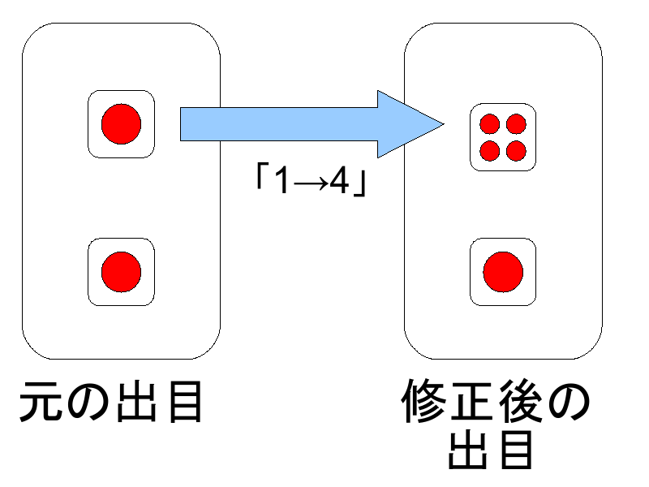
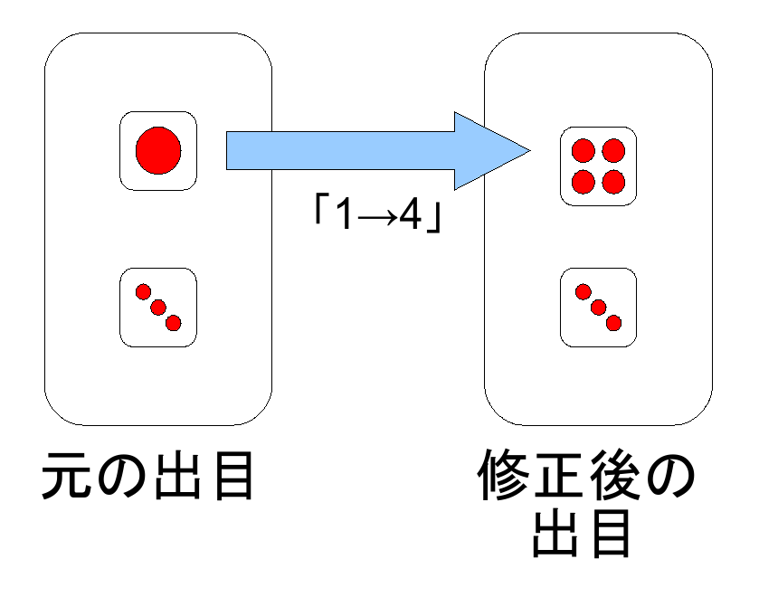
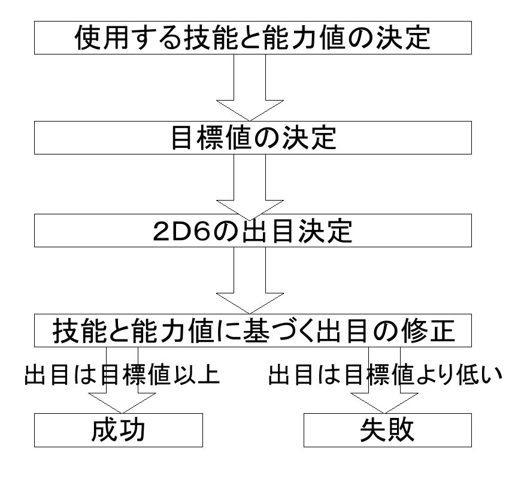

## 4.1判定方法

このゲームにおいて、すべての判定は2D6で目標値以上をふれば成功、となっています。目標値は状況によって決定されます。また、2D6の出目はその判定に関係する能力値と技能による修正を受けます。このゲームでは修正は振った6面体の出目を変えることができるというものです。すなわち「1→4」という修正は2D6で振った6面体のうち、1つの1を4に変えることができるということを表します。ただし、修正により2つの6面体の出目を両方とも修正することはできません。

例：

「1→4」の修正がある判定で2D6の出目が「3」と「1」だった場合は「1」が1→4と置き換えられ、合計は3+1=4ではなく、3

＋4=7で7となります。

元の出目修正後の「1→4」

出目

一方、出目が「1」と「1」の場合は、片方の「1」は1→4と置き換えられますが、もう片方は「1」のままなので4+1=5で合計は

5となるのです(4+4=8とならないことに注意してください！)。

元の出目修正後の「1→4」

出目判定の手順は以下の通りです。

使用する技能と能力値の決定目標値の決定２Ｄ６の出目決定技能と能力値に基づく出目の修正成功出目は目標値以上出目は目標値より低い失敗

こうした一連の手順は簡単に≪使用する能力値：使用する技能：目標値≫判定と表記されます。技能の練度はその分野の行動においてのキャラクタの練度を表しています。そして、その分野の行動においてはキャラクタは最大でもその練度から導かれる修正(表1)よりよい修正を受けることができません。技能は＜技能名：練度＞のように表記されます。

能力値の練度はある種の能力においてキャラクタがどれくらいの力を発揮できるかを表しています。ただし、その修正(表2)は行動の分野に対応した技能から導かれる限界修正により制限されてしまいます。能力値は［能力名：練度］のように表記されます。

また、技能を指定しない判定もあります。この場合、当然ながら技能により修正に制限が加わることはなく、その表記は≪使用する能力値：－：目標値≫のようになります。

あるいは、目標値が定数でなく、対立する判定者の振った2D6の出目である場合があります。この場合、≪使用する能力値：使用する技能：対決≫のようになります。

| 技能の修練度 | 修正値 |
| --- | --- |
| 0 | 6→4 |
| 1 | 6→5 |
| 2～3 | － |
| 4～5 | 1→2 |
| 6～8 | 1→3 |
| 9～11 | 1→4 |
| 12～15 | 1→5 |
| 16～19 | 1・2→4 |
| 20～23 | 1・2→5 |
| 24～27 | 1・2→6 |

### 図**2:**技能の修練度とダイス修正の関係

| 技能の修練度 | 修正値 |
| --- | --- |
| 0 | 6→4 |
| 1～3 | 6→5 |
| 4～8 | － |
| 9～15 | 1→2 |
| 16～24 | 1→3 |
| 25～35 | 1→4 |
| 36～48 | 1→5 |
| 49～63 | 1・2→4 |
| 64～80 | 1・2→5 |
| 81～99 | 1・2→6 |

### 図**3:**能力値の修練度とダイス修正の関係

例：

≪ソフトウェア(知力)：7≫判定と設定された行動があるとします。ここで＜ソフトウェア：3＞＜情報通：9＞［知力：23］のアルフ少尉がこの行動を試みた場合、得られる修正は「なし」です。本来、彼の知力なら「1→3」なのですが、ソフトウェア技能が低いため、彼はこの分野で力を発揮しきることができないのです。

一方、≪情報通(知力)：7≫判定と設定された行動があった場合、アルフ少尉が得られる修正は「1→3」です。彼は情報通技能が非常に高いため、知力を存分に発揮しきれるのです。このため、彼の技能ならば、さらに知力を伸ばし［知力：25］になったとしても能力修正である「1→4」をそのまま使うことができるのです！

