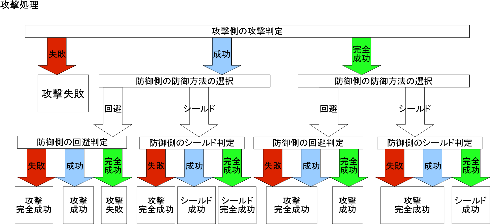
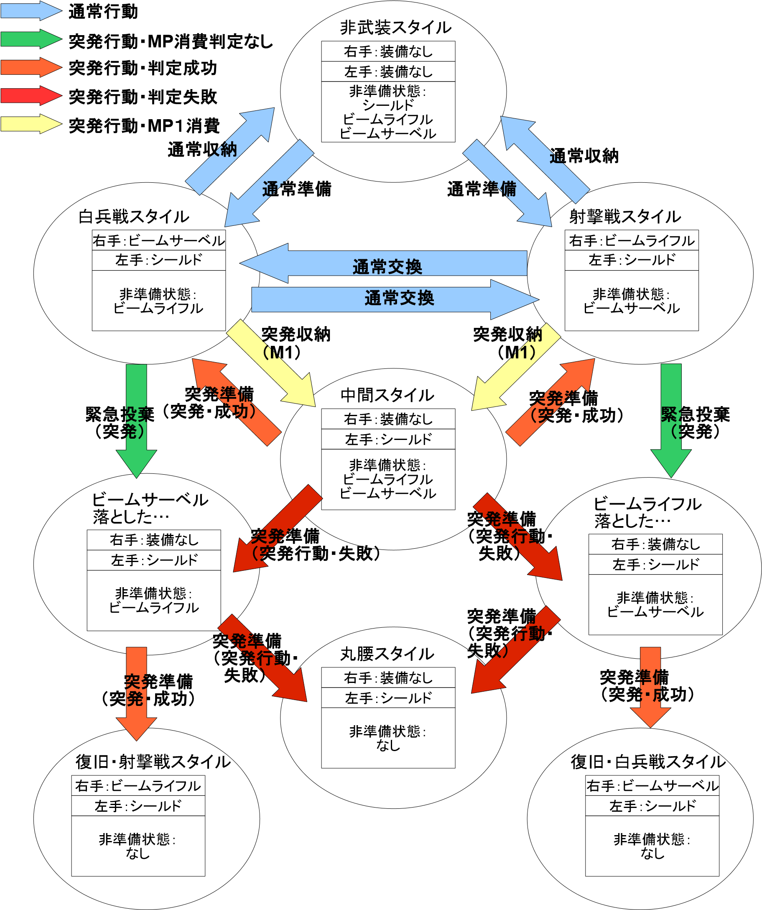

# 9．PADの詳細

攻撃処理の結果

| 処理結果 | ダメージ | ダメージ対象 | 説明 |
| --- | --- | --- | --- |
| 攻撃失敗 | ダメージなし | なし | 攻撃は失敗しました。 |
| 攻撃成功 | [武装効果÷2(切り上げ)]＋１Ｄ６ | 機体耐久 | 攻撃は目標に不完全に命中しました。 |
| 攻撃完全成功 | [武装効果]＋２Ｄ６ | 機体耐久 | 攻撃は目標に完全に命中しました。 |
| シールド完全成功 | [武装効果÷2(切り上げ)]＋１Ｄ６ | シールド耐久 | 攻撃はシールドに阻まれました。 |
| シールド成功 | [武装効果]＋２Ｄ６ | シールド耐久 | 攻撃はシールドで逸らされました。 |

特殊行動『受け止め専念』選択時の攻撃処理攻撃失敗攻撃側の攻撃判定防御側の防御方法の選択防御側の防御方法の選択成功完全成功失敗特殊行動『受け止め専念』シールド成功特殊行動『受け止め専念』シールド成功特殊行動『起動回避』選択時の攻撃処理

[図形データ: document-pict-026.xml](../../assets/shapes/document-pict-026.xml)

攻撃失敗攻撃成功攻撃側の攻撃判定防御側の防御方法の選択防御側の回避判定（ダイスボーナス＋２）防御側の防御方法の選択成功完全成功失敗防御側の回避判定（ダイスボーナス＋２）特殊行動『機動回避』特殊行動『機動回避』成功完全成功失敗成功完全成功失敗攻撃完全成功攻撃完全成功攻撃失敗攻撃成功

[図形データ: document-pict-027.xml](../../assets/shapes/document-pict-027.xml)

装備状態の変更と行動

通常移動フェイズの行動

| 行　動　名 | コスト | 説　　明 |
| --- | --- | --- |
| SFS通常移動　 | 行動　 | SFSの通常移動力の分だけヘクスを移動できる。SFS移動後に突発SFS離脱すると、さらに機体通常移動あるいは機体加速移動が可能(SFSの燃料-1) |
| 機体通常移動 | 行動 | 機体の通常移動の分だけヘクスを移動できる。 |
| 機体加速移動 | 行動 | 機体の加速移動の分だけヘクスを移動できる(燃料-1) |
| 不整地移動 | 行動 | 戦場が高高度・砂漠・水地・深海・暗礁宙域では機体通常移動はできず、こちらを使う。機体の通常移動の分だけヘクスを移動できる。局地操縦《運動：ＭＳ＊：８》に成功しないと追加移動フェイズがなくなり、次の移動フェイズまでダメージを除く全て判定の出目が-1される。(飛行装置があると高高度の局地操縦に自動成功、砂漠装備があると砂漠の局地操縦に自動成功、水陸装備があると水地の局地操縦に自動成功、潜行装置があると深海の局地操縦に自動成功、宇宙でも宇宙装備が無い場合機体通常移動できず、こちらになる。陸戦装備が無い場合、陸戦でも機体通常移動できず、こちらになる。) |
| SFS通常移動 | 行動 | SFSの通常移動力の分だけヘクスを移動できる。SFS移動後に突発SFS離脱すると、さらに機体通常移動あるいは機体加速移動が可能(SFSの燃料-1) |
| 機体射出 | 行動 | 射出に使用したカタパルトの射程分だけヘクスを移動できる。 |
| 機体追加移動　 | 行動　 | 機体の追加移動の分だけヘクスを移動できる(燃料-1) |

通常行動フェイズの行動（通常攻撃系）

| 行　動　名 | コスト | 説　　明 |
| --- | --- | --- |
| 陸戦格闘 | 行動 | 陸戦兵器のI属性武器で陸上の目標を攻撃する。修正なし。目標とスタックしているなら、次の自分の行動までの間、目標と格闘ロック状態になる。格闘ロックされた者は、ロックした側が許可するか振り切るまで自発移動不能。 |
| 空戦格闘 | 行動 | 空戦兵器のI属性武器で空中の目標を攻撃する。修正なし。目標とスタックしているなら、次の自分の行動までの間、目標と格闘ロック状態になる。格闘ロックされた者は、ロックした側が許可するか振り切るまで自発移動不能。 |
| 空間戦格闘 | 行動 | 空間戦兵器のI属性武器で宇宙の目標を攻撃する。修正なし。目標とスタックしているなら、次の自分の行動までの間、目標と格闘ロック状態になる。格闘ロックされた者は、ロックした側が許可するか振り切るまで自発移動不能。 |
| 陸戦射撃 | 行動 | 陸戦兵器のI属性がない武器で陸上の目標を攻撃する。修正なし。 |
| 空戦射撃 | 行動 | 空戦兵器のI属性がない武器で空中の目標を攻撃する。修正なし。 |
| 空間戦射撃 | 行動 | 空間戦兵器のI属性がない武器で宇宙の目標を攻撃する。修正なし。 |

通常行動フェイズの行動（特殊攻撃系）

| 行　動　名 | コスト | 説　　明 |
| --- | --- | --- |
| 打ち上げ射撃 | 行動 | 陸戦兵器のA属性とI属性がない武器で空中の目標を攻撃する。最大射程-1、命中判定の出目-1。 |
| 打ち下し射撃 | 行動 | 空戦兵器のL属性とI属性がない武器で陸上あるいは水中の目標を攻撃する。最大射程-1、命中判定の出目-1。 |
| 射界割れ射撃 | 行動 | I属性以外で最低射程2以上の武器スタックした目標を攻撃する。命中判定の出目-2。ただし、ダメージ+4。 |
| 複数武器攻撃 | 行動 | 射程の重複する、複数の武器で、単一の目標を攻撃する。ダメージは、一番低い武器を基準にし、使用する武器の数に応じて、＋１する（2個の武器なら＋１、3つなら＋２、４つなら＋３）。ただし、命中判定の出目はー２． |
| ジャンプ攻撃 | 行動 | 陸戦兵器が移動力1を使うことで最大射程0の武器で空中の目標を攻撃する。修正なし。曲乗り《運動：ＭＳ＊：８》に失敗すると攻撃判定事態が起きない。曲乗りの成否にかかわらず、直、ちに着地を行う必要がある。 |
| 急降下攻撃 | 行動 | 空戦兵器が移動力1を使うことで最大射程0の武器で陸上あるいは水中の目標を攻撃する。修正なし。曲乗り《運動：ＭＳ＊：８》に失敗すると攻撃判定事態が起きない。曲乗りの成否にかにかわらず、直ちに急上昇を行う必要がある。 |
| 制圧射撃 | 行動 | 最大射程1以上のI属性なし武器の射程内の1ヘクスを指定し、使用する兵装の弾数-1する。指定へクスは制圧射撃中と分かる。踏み込んだ対象は無条件で射撃ロック状態になる。射撃ロックされた者は、ロックした側が許可するか振り切るまで自発移動不能。複数の武器を使用するための予測射撃《技量：戦術：８》に成功すれば、使用した武器の数のヘクスまで指定可能。 |
| 制圧射撃＋攻撃 | 行動 | 予測射撃《技量：戦術：８》に成功すれば、最大射程1以上のI属性なし武器の射程内の対象１機を指定し、攻撃する。攻撃された対象は無条件で射撃ロック状態になる。射撃ロックされた者は、ロックした側が許可するか振り切るまで自発移動不能。対象のいたヘクスには制圧射撃したのと同等の効果が残る。予測射撃《技量：戦術：８》に失敗した場合、行動は終了し、何も出来ない。 |

通常行動フェイズの行動（特殊行動系）

| 行　動　名 | コスト | 説　　明 |
| --- | --- | --- |
| 通常装填 | 行動 | 片手が空いた状態での「弾装の交換」 |
| 通常準備 | 行動 | 空いている手に対して、任意の「非準備状態」の兵装を「準備状態」にする |
| 通常交換 | 行動 | 手の状態に関係なく、任意の1つのH属性兵装を「準備状態」から「非準備状態」にし、別の任意の1つのH属性兵装を「非準備状態」から「準備状態」にする。 |
| 装備回収 | 行動 | そのヘクスに投棄された兵装を空いている手の数だけ回収し、本体が持つ兵装に出来る |
| 装備収納 | 行動 | 装備中の任意の兵装を全て「非準備状態」にする。 |
| 装備展開 | 行動 | 「格納状態」の兵装を「非準備状態」にする(片手は空である事) |
| 押し出し | 行動 | 格闘を命中後させ、ダメージ判定の代わりに格闘勝負《運動：ＭＳ＊：対決》し、勝利した場合は目標を任意の隣接へクスに移動させる。ただし、この格闘勝負の出目には機体出力を加え加る。 |
| 押さえ込み | 行動 | 格闘を命中後させ、ダメージ判定の代わりに格闘勝負《運動：ＭＳ＊：対決》し、勝利した場合は目標は行動不能。ただし、この格闘勝負の出目には機体出力を加える。 |
| 機体脱出 | 行動 | 機体を捨てる。パイロットは自動かつ安全にそのヘクスに出現する。 |
| 説得 | 行動 | 目標側の勢力の数が劣っている場合、および、目標の行動が目標スタックした目標あるいは索敵範囲内にいる自分を攻撃した目標と議論勝負《知力：指揮：対決》し、勝利した場合は目標は、説得者の話に耳を傾けます。無条件に説得に従うわけではありません。 |
| 感応説得 | 行動 | スタックした目標に対し、 |
|  |  |  |

追加移動フェイズの行動表

| 行　動　名 | コスト | 説　　明 |
| --- | --- | --- |
| 機体追加移動 | 行動 | 機体の追加移動の分だけヘクスを移動できる(燃料-1) |
| 機体追加加速 | 行動 | 機体の追加加速の分だけヘクスを移動できる(燃料-1) |
| SFS追加移動 | 行動 | SFSの通常移動力の分だけヘクスを移動できる(SFSの燃料-1) |
| 格納装置爆破 | 突発　 | 本体の武装ラックを破壊し、それに格納された兵装を全て装備可能状態にする。兵装はヘクスに投棄された扱い。 |

突発行動

| 行　動　名 | コスト | 説　　明 |
| --- | --- | --- |
| 突発装填 | 突発 | 行動フェイズで使用可能。高速動作《技量：ＭＳ＊：８》に成功すれば、「弾装の交換」可能。高速動作に失敗すると弾薬をそのヘクスに投棄。(片手は空である事) |
| 突発準備 | 突発 | 高速動作《技量：ＭＳ＊：８》に成功すれば、「非準備状態」の兵装かヘクスに投棄されたH属性兵装1つを「準備状態」に出来る。高速動作に失敗すると兵装をそのヘクスに投棄。(片手は空である事) |
| 緊急投棄 | 突発 | 任意のＨ属性兵装をそのヘクスに投棄。失敗はない。 |
| 格納装置爆破 | 突発 | 本体の武装ラックを破壊し、それに格納された兵装を全て装備可能状態にする。兵装はヘクスに投棄された扱い。 |
| 格闘ロック振り切り | 突発 | 格闘ロックされているもの(被ロック者)のみ可能。格闘勝負《運動：ＭＳ＊：対決》を行う。被ロック者が勝利すると移動可能。ロ被ロック者が敗北した場合、被ロック者はそのラウンド、自律移動不可能。 |
| 射撃ロック振り切り | 突発 | 射撃ロックされているもの(被ロック者)のみ可能。射撃勝負《技量：ＭＳ＊：対決》を行う。被ロック者が勝利すると移動可能。ロ被ロック者が敗北した場合、被ロック者はそのラウンド、自律移動不可能。 |
| 突発機体脱出 | 突発 | 緊急脱出《運動：体術：機体の脱出難度》に成功すれば機体を捨て、パイロットは自動かつ安全にそのヘクスに出現する。緊急脱出に失敗するとパイロットは直前に機体が受けたダメージと等しいダメージを受ける。 |
| 突発機体射出 | 突発 | 移動フェイズ、行動フェイズで使用可能。射出に使用したカタパルトの射程分だけヘクスを移動できる。曲乗り《運動：ＭＳ＊：８》で失敗すると、それ以降の通常移動フェイズ、行動フェイズ、追加移動フェイズは行動できなくなる |
| 着地 | 突発 | 何らかの理由で空中にいた陸戦兵器が地上に降りた際に発生し、曲乗り《運動：ＭＳ＊：８》で失敗すると、機体耐久-2D6 |
| 急上昇 | 突発 | 何らかの理由で地上にいた空戦兵器が空中に戻る際に発生し、曲乗り《運動：ＭＳ＊：８》で失敗すると、機体耐久-2D6 |
| 高度変更 | 突発 | 空戦兵器かつ陸戦兵器が、移動力1を使用して陸上から空中、あるいは空中から陸上に高度を変更する |
| 深度変更 | 突発 | 潜行装置と水陸装備を持つ兵器が、移動力1を使用して水中から深海、あるいは深海から水中に高度を変更する |
| 突発収納 | Ｍ１ | 高速動作《技量：ＭＳ＊：８》に成功すれば、「準備状態」のＨ属性兵装を「非準備状態」にする。高速動作に失敗すると兵装をそのヘクスに投棄。 |
| 突発回収 | Ｍ１ | 高速動作《技量：ＭＳ＊：８》に成功すれば、そのヘクスに投棄された兵装を空いている手の数だけ回収し、「非準備状態」の兵装に出来る。 |
| 突発挺身防御 | Ｍ１ | 割り込み《運動：ＭＳ＊：８》に成功すれば、味方への損害判定後にスタック中の味方の受ける損害を引き受ける。 |
| 突発兵装受領 | Ｍ１ | 精密操作《技量：ＭＳ＊：８》に成功すれば、スタック中の味方から任意の兵装を1つ受け取る。兵装は「準備状態」になる。 |
| 突発兵装移譲 | Ｍ１ | 精密操作《技量：ＭＳ＊：８》に成功すれば、スタック中の味方に任意の兵装を1つを渡す。兵装は「準備状態」になる。 |
| 突発SFS離脱 | Ｍ１ | 遠隔操作《知力：通信：８》に成功すれば、装備中のSFSから機体を切り離せる。SFSはそのヘクスにある。 |
| SFS自動帰還 | Ｍ１ | 遠隔操作《知力：通信：８》に成功すれば、スタック中のSFSを緊急離脱により戦場から除外し指定したポイントに移動できる。 |

自律移動＝通常移動、通常加速、追加移動、追加加速、瞬発移動

| 経歴名 | 技能(選択) | 特技 | 運動 | 技量 | 反応 | 体力 | 知力 | 精神 |
| --- | --- | --- | --- | --- | --- | --- | --- | --- |
| 3年待った | 通信, 歩兵火器(宇宙ＭＳ, 地上ＭＳ) | ＭＳ格闘熟練, 耐Ｇ | 6 | 4 | 4 | 4 | 5 | 3 |
| MSレーサー | 宇宙ＭＳ, 地上ＭＳ(航宙機, 航空機) | 耐Ｇ,曲乗り熟練 | 4 | 4 | 6 | 4 | 3 | 5 |
| Ｃ調隊長 | 情報通, 指揮(隠蔽, 体術) | 曲乗り熟練, 機動回避 | 4 | 4 | 6 | 3 | 4 | 5 |
| アマチュアMS乗り | 宇宙ＭＳ, 地上ＭＳ(メカニクス, ソフトウェア) | 曲乗り熟練,ＭＳ格闘熟練 | 6 | 4 | 4 | 5 | 4 | 3 |
| アングラネットマネージャー | ソフトウェア, 隠蔽(情報通, 芸術) | 遠隔操作熟練, 瞬発移動 | 4 | 4 | 6 | 4 | 5 | 3 |
| コロニー公社の作業員 | 宇宙ＭＳ, 航宙機(メカニクス, 通信) | 遠隔操作熟練, 局地戦熟練 | 4 | 6 | 4 | 3 | 5 | 4 |
| ジャンク屋 | メカニクス, ソフトウェア(宇宙ＭＳ, 車両) | 曲乗り熟練, 局地戦熟練 | 4 | 6 | 4 | 3 | 5 | 4 |
| テストパイロット | ソフトウエア, 博識(地上ＭＳ, 宇宙ＭＳ) | 遠隔操作熟練, 対艦戦熟練 | 4 | 6 | 4 | 3 | 5 | 4 |
| プログラム技術者 | ソフトウェア, 博識(通信, 戦術) | 先読み,対艦戦熟練 | 4 | 6 | 4 | 4 | 5 | 3 |
| ボロで勇戦 | 個人格闘, 体術(地上ＭＳ, 宇宙ＭＳ) | シールド専念, 機動回避 | 4 | 6 | 4 | 4 | 3 | 5 |
| 宇宙軍兵士 | 航宙機, 宇宙ＭＳ(艦艇, 通信) | 対艦戦熟練, 戦術射撃 | 4 | 4 | 6 | 3 | 5 | 4 |
| 衛生兵 | 博識, 医術(通信, 砲撃) | 機会射撃, 瞬発移動 | 6 | 4 | 4 | 3 | 5 | 4 |
| 海軍兵士 | 艦艇, 通信(車両, ソフトウエア) | ＭＳ射撃熟練先読み | 4 | 4 | 6 | 5 | 4 | 3 |
| 外交官 | 指揮, 戦術(宇宙ＭＳ, 博識) | 指揮熟練, 先読み | 4 | 4 | 5 | 3 | 5 | 4 |
| 技術仕官 | ソフトウェア, メカニクス(指揮, 博識) | 戦術射撃, 遠隔操作熟練 | 4 | 6 | 4 | 3 | 5 | 4 |
| 教官 | 個人格闘, 戦術(宇宙ＭＳ, 地上ＭＳ) | 瞬発移動, 指揮熟練 | 6 | 4 | 4 | 5 | 4 | 3 |
| 苦労人 | 戦術, 情報通(指揮, 医術) | 局地戦熟練, 指揮熟練 | 4 | 6 | 4 | 3 | 4 | 5 |
| 空軍兵士 | 航空機, 通信(航宙機, 戦術) | 機動回避, 曲乗り熟練 | 4 | 6 | 4 | 4 | 5 | 3 |
| 軍楽隊 | 艦艇, 芸術(砲撃, 戦術) | 戦術射撃複数武装熟練 | 4 | 4 | 6 | 4 | 5 | 3 |
| 撃墜王 | 航空機, 戦術(宇宙ＭＳ, 航宙機) | 機会射撃, 対艦戦熟練 | 4 | 6 | 4 | 3 | 4 | 5 |
| 元捕虜 | 博識, 医術(通信, 艦艇) | 機会射撃, 瞬発移動 | 4 | 4 | 6 | 4 | 3 | 5 |
| 孤立無援 | 通信, メカニクス(宇宙ＭＳ, 地上ＭＳ) | 複数武装熟練高速準備 | 4 | 4 | 6 | 5 | 3 | 4 |
| 残党狩り | 情報通, 戦術(宇宙ＭＳ, 車両) | 両手攻撃, 戦術射撃 | 4 | 6 | 4 | 5 | 4 | 3 |
| 戦車兵 | 車両, 砲撃(メカニクス, 隠蔽) | ＭＳ射撃熟練高速準備 | 4 | 6 | 4 | 5 | 3 | 4 |
| 前線帰り | 地上ＭＳ, 体術(個人格闘, 隠蔽) | 機動回避, 曲乗り熟練 | 6 | 4 | 4 | 5 | 3 | 4 |
| 窓際勤務 | メカニクス, ソフトウエア(砲撃, 歩兵火器) | 高速準備, 戦術射撃 | 4 | 4 | 6 | 5 | 3 | 4 |
| 知性派隊長 | 指揮, 博識(芸術, 戦術) | 遠隔操作熟練, 先読み | 4 | 6 | 4 | 3 | 4 | 5 |
| 地獄を見た | 隠蔽, 情報通(宇宙ＭＳ, 地上ＭＳ) | 先読み, 耐Ｇ | 6 | 4 | 4 | 3 | 4 | 5 |
| 地上軍兵士 | 航空機, 歩兵火器(地上ＭＳ, 車両) | ＭＳ格闘熟練, 局地戦熟練 | 6 | 4 | 4 | 5 | 4 | 3 |
| 突撃兵 | 歩兵火器, 体術(隠蔽, 地上ＭＳ) | 機動回避, 瞬発移動 | 6 | 4 | 4 | 5 | 3 | 4 |
| 肉体派隊長 | 体術, 指揮(歩兵火器, 個人格闘) | ＭＳ格闘熟練, 耐Ｇ | 6 | 4 | 4 | 4 | 3 | 5 |
| 不良仕官 | 通信, 情報通(隠蔽, 戦術) | 機動回避, 局地戦熟練 | 4 | 4 | 6 | 4 | 5 | 3 |
| 不良兵士 | 情報通, 隠蔽(個人格闘, 芸術) | ＭＳ格闘熟練, 曲乗り熟練 | 6 | 4 | 4 | 3 | 4 | 5 |
| 無職 | 個人格闘, メカニクス(隠蔽, 医術) | 局地戦熟練, シールド専念 | 6 | 4 | 4 | 5 | 3 | 4 |
| 優等生 | 通信, 戦術(指揮, 博識) | シールド専念, 戦術射撃 | 4 | 6 | 4 | 4 | 5 | 3 |

ＭＳ格闘熟練　[熟練度上昇時の習得時は運動の錬度50以上が必要]

| 特殊行動 | コスト | 説　　明 |
| --- | --- | --- |
| 白兵武器熟練 | 自動 | I属性武器の損害判定時「1→2」。格闘勝負《運動：ＭＳ＊：対決》のダイス目+1 |
| 移動後牽制 | Ｍ１ | 追加移動あるいは追加加速後にスタックした目標と次の自分の行動までの間、格闘ロック状態になる。 |
| 切り払い | ＭＰ | I属性武器による命中時、防御判定に代わりに行い、格闘勝負《運動：ＭＳ＊：対決》で目標が勝利しない限り、攻撃を無効化する。命中判定は一次成功でも完全成功でも関係しない(I属性武器を装備している事)。さらに、この判定に関わらず、Ｃ属性は無視する。 |

ＭＳ射撃熟練　[熟練度上昇時の習得時は技量の錬度50以上が必要]

| 特殊行動 | コスト | 説　　明 |
| --- | --- | --- |
| 射撃武器熟練 | 自動 | I属性なし武器の損害判定時「1→2」、射撃勝負のダイス目+1 |
| 曲撃ち | Ｍ１ | 「打ち上げ射撃」「打ち下し射撃」「射界割れ射撃」のペナルティが無くなる。 |
| 狙撃 | ＭＰ | 通常移動フェイズに移動しない場合のみ使用可能。I属性以外で最大射程2 以上の武器の攻撃が射程×1.5(切捨て)で大打撃になる(損害判定時「1・2→4」で目標は防御判定の目標値+1)。ただし、次の自分の行動までPADを除く自律移動、自律防御が不可能。 |

シールド熟練　[熟練度上昇時の習得時は反応の錬度50以上が必要]

| 特殊行動 | コスト | 説　　明 |
| --- | --- | --- |
| 受け流し熟練 | 自動 | シールドの装甲+1 |
| 受け止め専念 | Ｍ１ | シールド防御判定《反応：ＭＳ＊：＊》は自動成功。命中判定は一次成功でも完全成功でも関係しない。 |
| 損害制御 | ＭＰ | 自分への最終的な損害点を最大機体耐久30点ごとに-1D6する(30点以下は1D6-3(最低1)) |

瞬発移動　[熟練度上昇時の習得不能]

| 特殊行動 | コスト | 説　　明 |
| --- | --- | --- |
| 移動熟練 | 自動 | 出撃時、機体の燃料+1 |
| 挺身防御 | Ｍ１ | 味方への損害判定後にスタック中の味方の受ける損害を引き受ける。この時に瞬発移動の宣言が可能(ＭＰ消費)。通常の瞬発移動とことなり、通常移動、加速移動に加え、通常移動＋追加移動、加速移動＋追加加速で移動することが可能。もちろん、燃料やHPへの減点は通常通り |
| 瞬発移動 | ＭＰ | 燃料消費して「移動」前あるいは「行動」後に通常移動あるいは加速移動分だけ移動(HP-1D6ただし、耐Gがあるならば0点・追加移動あるいは追加加速は出来ない)。超加速属性扱い。 |

高速準備　[熟練度上昇時の習得不能]

| 特殊行動 | コスト | 説　　明 |
| --- | --- | --- |
| 高速動作熟練 | 自動 | 高速動作《技量：ＭＳ＊：＊》の目標値-2(目標値が6以下ならば自動成功) |
| 高速回収 | Ｍ１ | そのヘクスに投棄された任意の兵装を全て回収し、本体が持つ兵装に出来る。回収した兵装は望むならば、手の数に応じた数の兵装まで「準備状態」にできる |
| 緊急装備展開 | ＭＰ | 行動権を消費せずに、「格納状態」の兵装を「非準備状態」にする(片手は空である事) |

複数武装熟練　[熟練度上昇時の習得不能]

| 特殊行動 | コスト | 説　　明 |
| --- | --- | --- |
| 複数武器攻撃熟練 | 自動 | 2武器使用時は損害効果が「より小さい方+1」になる。使用する武器が増えれば、1個につき+1であり、2つなら+1、3つなら+2、4つならば+3。命中判定への修正は無い。 |
| 複数目標攻撃 | Ｍ１ | 移動フェイズに移動しない場合のみ使用可能。攻撃目標数を+1する。さらにMP-1すれば攻撃目標数+1。複数の武器で複数の目標を攻撃可能。(目標数に応じた武器を装備している必要がある)ただし、次の自分の行動までPADを除く自律移動、自律防御が不可能。 |
| 一点攻撃 | ＭＰ | 2武器使用時は損害効果が「より小さい方+4」になる。使用する武器が増えれば、1個につき+1であり、2つなら+1、3つなら+2、4つならば+3 |

曲乗り熟練　[熟練度上昇時の習得不能]

| 特殊行動 | コスト | 説　　明 |
| --- | --- | --- |
| ロデオ | 自動 | 曲乗り《運動：ＭＳ＊：＊》の目標値-3(ただし、目標値は5以下にはならない。最低6) |
| すり抜け | Ｍ１ | 2ユニットがスタックしたヘクスを飛び越える(そのヘクス通過時は移動力を消費しない) |
| 隠密行動熟練 | ＭＰ | 1ラウンドの間、制圧射撃・足止め射撃・追撃射撃、回り込み、移動阻止射撃の対象とならない |

機動回避　[熟練度上昇時の習得不能]

| 特殊行動 | コスト | 説　　明 |
| --- | --- | --- |
| 最適機動 | 自動 | 出撃時、機体の燃料+1 |
| 一撃離脱 | Ｍ１ | 「行動フェイズ」と「通常移動フェイズ」の順番を交換可能。(航空機・航宙機はMP消費なし) |
| 機動回避 | ＭＰ | 燃料消費して回避判定《反応：ＭＳ＊：＊》の目標値-2(一時的に超加速属性が付加される) |

機会射撃　[熟練度上昇時の習得不能]

| 特殊行動 | コスト | 説　　明 |
| --- | --- | --- |
| 警戒熟練 | 自動 | 隠蔽を使用した判定の目標値-2(目標値が6以下ならば自動成功) |
| 足止め射撃 | Ｍ１ | 現在装備中の武装で攻撃可能である位置で行動を終了した目標の追加移動フェイズに宣言し、追加移動フェイズでの行動を無くす。 |
| 機会射撃 | ＭＰ | 現在装備中の最大射程1以上のI属性なし武装で攻撃可能である位置で通常移動フェイズを開始した目標に対して宣言し、その通常移動フェイズでの行動を無くす |

局地戦熟練　[熟練度上昇時の習得不能]

| 特殊行動 | コスト | 説　　明 |
| --- | --- | --- |
| 砂漠戦熟練 | 自動 | 局地操縦《運動：ＭＳ＊：＊》の目標値-2(目標値が6以下ならば自動成功) |
| 極限環境耐性 | Ｍ１ | 暑さ・寒さ・低酸素など環境が原因の体力に基づく判定は自動成功 |
| 軽業熟練 | ＭＰ | 体術を使用した判定の目標値-2(目標値が6以下ならば自動成功) |

耐Ｇ　[熟練度上昇時の習得不能]

| 特殊行動 | コスト | 説　　明 |
| --- | --- | --- |
| 耐Ｇ | 自動 | 超加速属性によるHP損害を無視する |
| 頑強 | Ｍ１ | LPへの損害決定時の修正を[3・4・5・6→2]にする |
| 強靭体力 | ＭＰ | 体力に基づく判定の目標値-2(目標値が6以下ならば自動成功) |

指揮熟練　[熟練度上昇時の習得不能]

| 特殊行動 | コスト | 説　　明 |
| --- | --- | --- |
| 説得熟練 | 自動 | 議論勝負《精神：指揮：対決》のダイス目+2 |
| 敵指揮観察 | Ｍ１ | 1回/R。次のラウンドの味方側のイニシアティブ判定《知力：指揮：対決》の目標値-1。 |
| 指揮誘導 | ＭＰ | 自分の行動の前に任意の味方一人を通常移動の半分(最低1)移動させる(一人には1回/Rのみ使用可能で対象者はMP-1ただし、対象が上官である場合 MP-2)。例外として、味方が受けた損害判定が確定した後にのみ、割り込みで指揮誘導を使用可能とする。この時は、指揮誘導で移動可能な範囲の味方にスタックし、その味方の受ける損害を引き受けさせることが出来る。この場合も対象者はMP-1ただし、対象が上官である場合MP-2だが、指揮誘導の使用可能回数制限には抵触しない。なお、例外使用時は庇う対象の味方にスタックする以外では移動することはできず、かならずスタックしたヘクスで停止する。 |

先読み　[熟練度上昇時の習得不能]

| 特殊行動 | コスト | 説　　明 |
| --- | --- | --- |
| 平常精神 | 自動 | MPへの損害決定時の修正を[3・4・5・6→2]に |
| 戦術熟練 | Ｍ１ | 《＊：戦術：＊》の目標値-2(目標値が6以下ならば自動成功) |
| 先読み攻撃 | ＭＰ | I属性なし武器の命中判定を知力修正で行う(目標は回避判定に反応修正を使用できずかつ判定目標値+2) |

戦術射撃　[熟練度上昇時の習得不能]

| 特殊行動 | コスト | 説　　明 |
| --- | --- | --- |
| 制圧射撃熟練 | 自動 | 予測射撃《技量：戦術：＊》の目標値-2(目標値が6以下ならば自動成功) |
| 牽制射撃 | Ｍ１ | 自分の追加移動フェイズ終了時に目標を指定する。索敵範囲の目標を指定。指定した味方に届く射程1以上のI属性なし武器の弾数-1により「防御判定の達成値+1」「射撃or格闘ロック振り切りの達成値+2」「足止め射撃無効」「追撃射撃無効」1目標にMP-1。実際に効果を発生させた時点で弾数-1。目標に届く武器が無ければ使えない。 |
| 連携攻撃 | ＭＰ | 味方が攻撃した目標に対して連携攻撃を行うことで回避判定の目標値+2あるいは損害効果+4できる(2人まで重複可能) |

遠隔操作熟練　[熟練度上昇時の習得不能]

| 特殊行動 | コスト | 説　　明 |
| --- | --- | --- |
| SFS回避 | 自動 | SFS装備時でも本体の回避力で回避可能 |
| 遠隔操作熟練 | Ｍ１ | 遠隔操作《知力：通信：＊》の目標値-2(目標値が6以下ならば自動成功) |
| 通信熟練 | ＭＰ | 《＊：通信：＊》の目標値-2(目標値が6以下ならば自動成功) |

対艦戦熟練　[熟練度上昇時の習得不能]

| 特殊行動 | コスト | 説　　明 |
| --- | --- | --- |
| 対艦攻撃 | 自動 | 命中判定の目標値-2かつ損害判定時の損害点+1D6 |
| 対艦防御 | Ｍ１ | 艦船からの攻撃に対する回避判定目標値-2(回避判定前に宣言。シールドは不可) |
| 精密爆破 | ＭＰ | 艦船への損害表を余分に2回振り、任意の効果を選択可能(損害表判定前に宣言) |

| 改造名 | 内容 | 必要功績点 | メリット | デメリット | 前提 | 重複 |
| --- | --- | --- | --- | --- | --- | --- |
| 専用カラー | 機体を自分専用のカラーリングに塗り替える(迷彩ではなく、自己識別用の色に限る) | 5 | パイロットのMP+1 | 個体識別される | ジオン公国、アクシズ、ネオジオンに所属し、カスタマイズを2つ以上した機体にのみ適用可能 | 不可能 |
| パーソナルエンブレム | 自分の機体に自分専用のエンブレムあるいはノーズアートを描く | 5 | パイロットのMP+1 | 個体識別される | 地球連邦軍、エゥーゴに所属し、カスタマイズを2つ以上した機体にのみ適用可能 | 不可能 |
| ブレードアンテナ装備 | 頭部に隊長マークを兼ねたブレードアンテナを装備する | 10 | 部隊に所属する全パイロットのMP+1 | 要求パイロットレベル+1 | ジオン公国、アクシズ、ネオジオンに所属する指揮官機のみ | 不可能 |
| 部隊章 | 部隊所属の機体に統一のエンブレムあるいはノーズアートを描く | 10 | 部隊に所属する全パイロットのMP+1 | 要求パイロットレベル+1 | 地球連邦軍、エゥーゴに所属する指揮官機のみ | 不可能 |
| ジェネレータチェーン | 核融合炉を過稼動させ、出力を強制的に引き上げる | 5 | 出力+1 | 要求パイロットレベル+1、プロペラントの代わりに冷却材を搭載するため、燃料容量-2 | なし | 不可能 |
| ジェネレータ大型化 | より大型の核融合炉を搭載し、出力を上げる | 15 | 出力+3 | 要求パイロットレベル+2、機体のバランスが悪化するため動きが悪くなり、完全回避+1、完全命中+1 | なし | 不可能 |
| 増設プロペラント装備 | 機体の外部に増設プロペラントタンクを装備する | 5 | 燃料+3 | 要求パイロットレベル+1、プロペラントタンクの分シルエットが増加するため近接被弾が増加することにより、一次回避+1 | なし | 3回まで可能 |
| 高揮発性燃料使用 | 機体のプロペラントを爆発性の高い物に切り替え、加速力を高める | 10 | 燃料容量+5 | 要求パイロットレベル+1、被弾時のダメージがすべからく2 倍になる | なし | 不可能 |
| 軽量化 | 機体の装甲などを外し、軽量化することで運動性を上げる | 10 | 燃料容量+1、完全回避-1 | 要求パイロットレベル+2、機体の装甲を外したことで強度が下がり安定性も低下し、装甲強度-2、耐久性能-5、完全命中+1 | 重装甲化をしてないこと | 不可能 |
| 重装甲化 | 追加装甲を装備する | 5 | 装甲強度+2、耐久性能+2 | 要求パイロットレベル+1、機体重量が増加して機動時に必要なプロペラントが増加すると共に機動性自体も低下するため、燃料容量-1、一次回避+1 | 軽量化をしてないこと | 不可能 |
| スラスター増設 | スラスターを増設し、加速性能を向上する | 10 | 加速移動+2 | 要求パイロットレベル+2、燃料の消費が増加するため、燃料容量-2(燃料容量が0あるいはマイナスになるようなカスタマイズは出来ない) | なし | 不可能 |
| レーダー出力強化 | より高出力のレーダーを搭載し、索敵範囲を向上する | 10 | 索敵範囲+2 | 要求パイロットレベル+1、装甲の一部を外して積載したレーダに出力を回すため、機体出力-1、装甲強度-1 | なし | 2回まで可能 |
| 武装ラック装備 | 武装の積載用の荷台を増設する | 5 | 荷台に乗せた武装の負荷を半分扱いにする(切捨て、ただし最低0.5) | 要求パイロットレベル+1、二台には1つの武装しか積載できず、また、荷台上の武装は使用できず、荷台上の武装を使用可能状態にするには必ず1Rかかる | なし | 2回まで可能 |
| 重力下適応 | 機体の専用の装備の追加や重量バランスやスラスターバランスの調整をし、重力下における機体の適応を向上させる | 5 | 重力下の地形適応を1段階構造する | 要求パイロットレベル+1、無重力化の地形適応が1段悪化 | 無重力化適応をしてないこと | 3回まで可能 |
| 無重力下適応 | 機体の専用の装備の追加や重量バランスやスラスターバランスの調整をし、無重力下における機体の適応を向上させる | 5 | 無重力下の地形適応を1段階構造する | 要求パイロットレベル+1、重力化の地形適応が1段悪化 | 重力化適応をしてないこと | 3回まで可能 |
| ノーマライズ | 機体を標準状態に戻す | 5 | 全てのカスタマイズのデメリットは解消される | すべてのカスタマイズは失われる | カスタマイズが1つ以上 | 意味なし |

氏名

性別：男・女身長：　　cm体重：　　kg生年月日：UC00__.__.__

第一指針(1-4)第二指針(5-6)

　○生存：1-2連撃/3-4回避/5一撃/6威圧（1-3下手/4-5故障/6軽率　）○生存

　○防衛：1-2回避/3-4威圧/5支援/6特殊（1-3下手/4-5軽率/6故障　）○防衛

　○名誉：1-2ﾓﾗﾙ/3-4一撃/5特殊/6精度（1-3軽率/4-5故障/6下手　）○名誉

　○戦闘：1-2一撃/3-4精度/5連撃/6回避（1-3故障/4-5軽率/6下手　）○戦闘

　○主義：1-2威圧/3-4連撃/5ﾓﾗﾙ/6支援（1-3故障/4-5下手/6軽率　）○主義

　○調和：1-2特殊/3-4支援/5精度/6ﾓﾗﾙ（1-3軽率/4-5下手/6故障　）○調和熟練度主戦機・前衛主戦機・後衛パイロットレベル：

## 　○高速準備　○ＭＳ射撃熟練01 PL:1　○曲乗り熟練　○複数武装熟練0204 03 P 05 06 PLL::2 3

　○シールド専念　○先読み07 08 09 10 PL: 4消費ＭＰ：　○機会射撃　○局地戦熟練11 12 13 14 15 PL: 5 ○熟練度1：7護衛機・前衛護衛機・後衛16 17 18 19 20 21 PL: 6

○熟練度2：6　○耐Ｇ　○指揮熟練2229 23 24 25 26 27 28 P 30 31 32 33 34 35 36 PL: 7L: 8

○○熟練度熟練度34：：54　○瞬発移動　○戦術射撃37 38 39 40 41 42 43 44 45 PL: 9

○熟練度5：3　○機動回避　○対艦船熟練46 47 48 49 50 51 52 53 54 55 PL:10

○熟練度6：2　○ＭＳ格闘熟練　○遠隔操作熟練56 57 58 59 60 61 62 63 64 65 66 PL:11

67 68 69 70 71 72 73 74 75 76 77 78 PL:12

能力値修練度修正値修練度/修正値成長目標値：

変換表成長修正＿→＿運動　＿＿　＿→＿0：6→4

## 技量　＿＿　＿→＿1- 3： 6→5 ：　－　4-8成長目標値／修正値／成長パターン○熟練度能4･4技1|能3･31 5/1→5/･2技1反応　＿＿　＿→＿9-15：1→2○○熟練度熟練度23 6/1→4/ 7/1→3/能能43･･34技技00||能能23･･12･･21技技12

体力　＿＿　＿→＿16-24： 1→3 ： 1→4 25-35○熟練度4 8/1→2/能2･2技0|能1･1･0技2○熟練度能1･1技1|能1･0･0技25 9/1→1/

36-48：1→5○熟練度6 10/6→5/能1･0技0|能0･0･0技1

知性　＿＿　＿→＿49-63：1･2→4参考：初期PAD数(B=ﾎﾞｰﾅｽ、P=ﾍﾟﾅﾙﾃｨ)->精神　＿＿　＿→＿64-80：1･2→5熟練度1(B1/P5)、熟練度2(B2/P4)、

81-99：1･2→6熟練度熟練度3(5(B2/PB4/P3)1)、熟練度、熟練度4(6(B3/PB5/P2)0)、

LLKUC

From 0079 To 0093

階級

功績点1020軍曹曹長

30准尉

40少尉

60中尉

80大尉120少佐

（連邦軍は25三等准尉、30二等准尉、35一等准尉）所属

連邦・ジオン・ネオジオンティターンズ・エゥーゴ・ｶﾗﾊﾞ出身

地球・月・ｻｲﾄﾞ1・ｻｲﾄﾞ2・

ｻｲﾄﾞ3・ｻｲﾄﾞ4・ｻｲﾄﾞ5・ｻｲﾄﾞ6歴代乗機

## 撃墜記録

技能：指令工兵0：6→4

　指揮　　　＿　＿→＿　隠蔽　＿　＿→＿1：6→5　艦艇　　　＿　＿→＿　車両　＿　＿→＿2- 3：　－　

　通信　　　＿　＿→＿　ﾒｶﾆｸｽ＿　＿→＿4- 5：1→2修練度修正値　砲撃　　　＿　＿→＿　ｿﾌﾄｳｪｱ＿　＿→＿6- 8：1→3操縦歩兵知識9-11：1→4

　航空機　　＿　＿→＿　情報通　　＿　＿→＿　博識　＿　＿→＿12-15：1→5　航宙機　　＿　＿→＿　個人格闘　＿　＿→＿　戦術　＿　＿→＿16-19：1･2→4

　地上ＭＳ　＿　＿→＿　体術　　　＿　＿→＿　医術　＿　＿→＿20-23：1･2→5　宇宙ＭＳ　＿　＿→＿　歩兵火器　＿　＿→＿　芸術　＿　＿→＿24-27：1･2→6

感応感応最終限的なダイス目が、感応値と界= 5 +精神[＿]÷10 –等熟練度しいか、[＿]よ＝り（　　　）低い場合、[感応成功]となる。感応成功は達成値を+4、MP-1する。ラウンド中1回でも感応成功した場合は気絶判定しない。感応成功した場合、対抗者のダイス目と比較し、出目の合計が等しい場合、限界の範囲で両者の感応+1。まったく同じ目の場合感応+2。すべて選択の余地なし。元値= 16 +体力[＿]÷5＝（　　　）予備欄

ＨＰ

10か、それより低い場合、意識維持判定が必要（体力判定：8）

元値= 16 +精神[＿]÷5＝（　　　）

ＭＰ

10か、それより低い場合、意識維持判定が必要（体力判定：8）

ＰＡＤ：「　　　　　　　」：効果

「　　　　　　　」：効果

「　　　　　　　」：効果

「　　　　　　　」：効果

「　　　　　　　」：効果

「　　　　　　　」：効果

