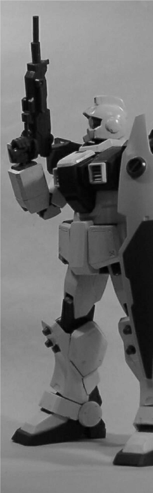
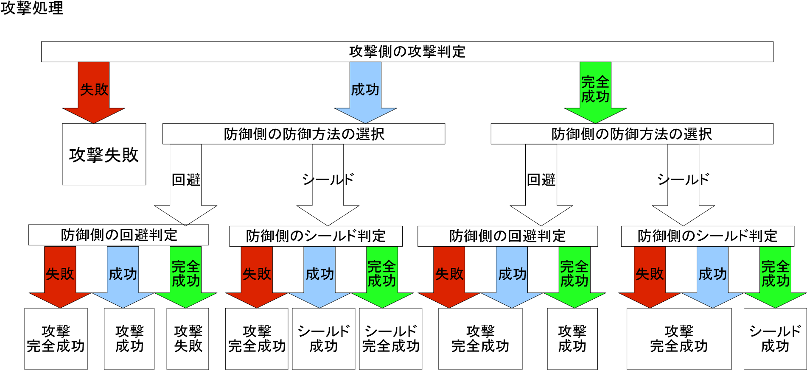
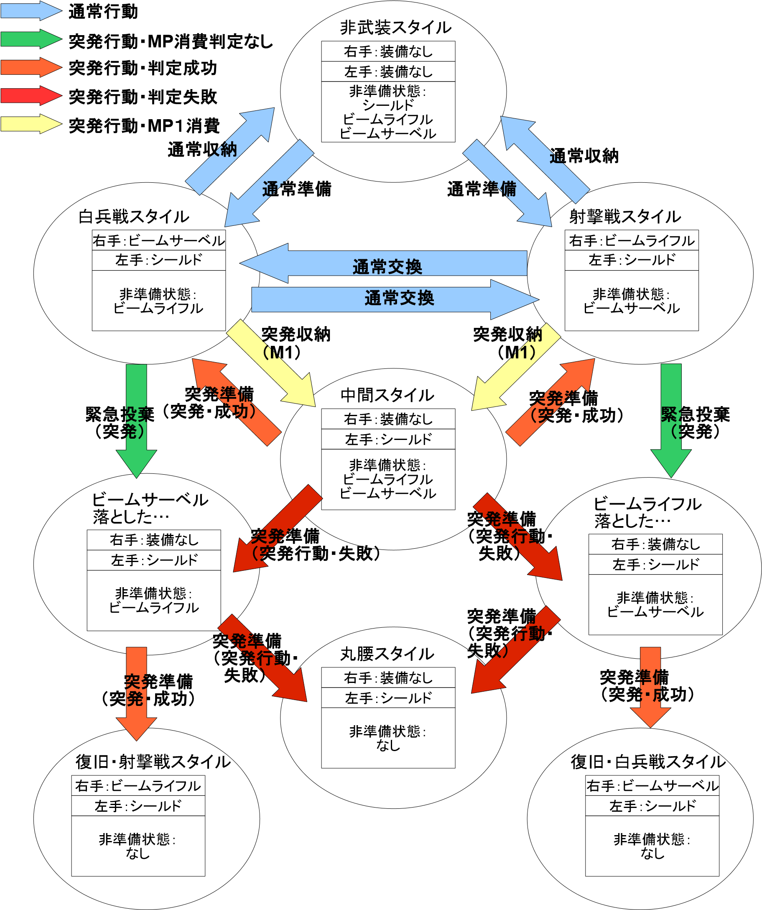

<!-- 本文は Word の段落スタイル・表から機械変換した初稿です。
     配置・テキストボックス・図形は assets/ooxml と assets/shapes を参照してください。 -->

From 0079

To 0093

Index　Space

# 1．前提

このルールはホビージャパンからでている「機動戦士ガンダムＲＰＧ」を元に制作されたものです。そのため、このルールは「機動戦士ガンダム」をよく知っていて、メンバーのうち誰かは「機動戦士ガンダムＲＰＧ」のルールを知っていることが前提となっています。

# 2．はじめに

世に数多くの「機動戦士シリーズ」、すなわち宇宙世紀を題材としたRPGがあります。しかし、それらの多くはシミュレーションとしては完成度が高いのですが、RPGとしては遊びにくいものとRPG部分に力を入れようとして失敗したものの2つに分類することができます。

このような問題から、私は自分達のプレイし易いガンダムRPGを開発しようと思い立ちました。また、その中であまりにも細かい計算を必要とする部分は削り、逆にプレイの目的となるものを多く内包したものに仕上げることを目標としました。

また、宇宙世紀と言ってもさまざまな時代があり、かつ、さまざまなメディアにおいて多くの人により自由奔放に創作活動が続けられてきました。

しかし、その全てを一括して扱うことには無理がありますし、世界観の統一も計れません。これに対し私はある一定の期間のある一定のメディアについてのみを対象とすることにしました。すなわち、アムロ＝レイとシャア＝アズナブルが生きた時代---

From 0079 To 0093---と。

つまり、このRole Playing Gameのシステムの本当の名前は---From 0079 To 0093---です。しかし、サークル野良騎士団内においてこの名称を使用するものは誰もおりません。我々は単にガンダムRPGと呼称しています。おそらく、この名前を聞いたことがないプレイヤ諸氏も多いはずです。なぜなら、デザイナーである私が滅多にこの名前で呼ばないからです。理由は当然、面倒だから、です。あなたはいちいち「ふろむだぶるおおせぶんてぃないんとぅだぶるおおないんてぃすりぃ」などと呼べるでしょうか？まぁ、システムの名前など、そんなものです。なお、システムの特徴として、以下の点が上げられます。2.1統一された判定法

あらゆる判定は使用する能力値(後述)と技能(後述)を決定しサイコロ(以下これを、6面体と呼ぶ)を2個振り(以下、この行動を2D6と呼ぶ)、その出目の合計を求める(以下これを、その合計値を2D6の出目と呼ぶ)ことで決定します。さまざまな修正が入ることが多々ありますがこの基本が変わることは決してありません。また、そのシステム自体が、力はどんどんつくがあっても生かせない場面もある新人と、安定してさまざまな場面で強い熟練の戦士を表せる、非常に機動戦士ガンダムの世界の雰囲気を味わいやすいようになっています

## 2.2充実したキャラクタ制作

プレイヤは宇宙世紀のさまざまなタイプのキャラクタを制作することができるようになっています。しかも、それらのルールは多量のデータ量にプレイヤが圧倒されない様、考慮され、望むなら数度6面体を振るだけでキャラクタが作れるようにもなっていますし、典型的なキャラクタのタイプに応じた、プレイヤがわずかに味付けを行なう分だけを未完成部分として残したキャラクタの制作例(以下これを、テンプレートと呼ぶ)も用意されています。当然のことながら一からプレイヤが望むように作ることもできます。また、このルールは新人のキャラクタを作るのは、このゲームに慣れていない人にも数分でできる程度に調整され、熟練兵のキャラクタを作るには幾ばくかの計画性と戦術眼、戦闘ルールなどへの知識、そして経験が必要なように調整されています。すなわち、さまざまな幅のプレイヤに対応できるようになっているのです。

また、本文において、新人のキャラクタを作ることは簡単であると繰り返し述べられていますが、これは、その分奥が深いとも言うことも可能なことです。そして、新人こそがシナリオを通して大きく変化することの多いキャラクタであることから、魅力的な新人キャラクタを創造し、有意義に演じることこそこのシステム醍醐味の一つです。なぜなら、「機動戦士シリーズ」において、多くの主人公(アムロ、カミーユ、ジュドー…)は少年---新人--なのですから！なお、当然ながら魅力的な熟練兵(ランバ＝ラル、ヤザン、ラカン…)も「機動戦士シリーズ」の醍醐味の一つだということも忘れてはいけません。ニュータイプなどとほざく若造どもに下手に出る必要などないのです！

## 2.3戦闘時諸行動とルールのスリム化

宇宙世紀の戦闘といえば、主にモビルスーツ(以下、MSと呼ぶ)によるものを指します。そして、戦闘は移動、及び攻撃の二つからなります。しかし、「機動戦士シリーズ」の物語中ではさまざまな人物が、通常では考えられないような特別な行動をとったりもします。このような観点からこのシステムにおいてもさまざまな行動に対するルールを定めています。しかし、新人のキャラクタが、プレイヤが戦闘ルールに熟知していればさまざまな行動を取れるというのは不自然ですし、参加プレイヤ全員に各場面での有効な特殊な行動をすべて網羅してもらうことは事実上難しいと言わざるを得ません(この文章を読んでいるあなたの周囲に居る、自分ではルールを読まずに他人に聞くことで済ませようとしている輩のことです！)。この問題に対し、このシステムでは「そのキャラクタの選択することが可能な特殊な行動」をキャラクタごとに定めることで、プレイヤが把握する必要のある特殊なルールの量を減らし、かつ、熟練兵は新兵よりもさまざまな行動が取れるようになっているのです。

## 2.4プレイヤにも熟練を促すシステム

この章では盛んに、熟練兵キャラクタは選択の幅が広く、創造するのも扱うのもプレイヤ自身に熟練を必要としていること、逆に新兵のキャラクタは容易であることを述べました。すなわち、このルールや戦闘ゲーム、またはRPGに慣れていないプレイヤほど新人のキャラクタを演じることが推奨されている、ということです。これは、プレイヤに応じたプレイ環境を提供するという考え方に乗っ取りこのシステムが制作されているためです。しかし、ゲームを続けるうちにプレイヤ自身はどんどん慣れ、または、慣れたものの行動を見るなどし、熟練者へとなっていくでしょう。それでもキャラクタが新人のままならば、きっとそのプレイヤは飽きてしまうことでしょう。この問題を解決するため、このシステムでは通常の成長(後述)とは別に、キャラクタを任意に熟練させていくというルールが用意されています。このルールによってプレイヤは無理なくゲームに熟練していくことになるでしょう。このシステムのもう一つの狙いは最近軽視されがちな戦術眼を、このゲームを通してプレイヤに身につけてもらうことだからなのです。

# 3．ゲームの準備

このシステムはRPGという形を取っています。そのため、ゲームを行なうためには以下のものを用意する必要が有ります。

ゲームマスター1人プレイヤ3から6人

ルールブック最低1部(できれば全員分)シナリオ最低1つ

テーブルプレイヤ１プレイヤ２プレイヤ４プレイヤ３ＧＭマスタースクリーンシナリオルールブック

[図形データ: document-pict-001.xml](../assets/shapes/document-pict-001.xml)

図**1:**ゲームの準備

## 3.1ゲームマスター

ＧＭは、以下ＧＭと呼びます。

多くの場合、この冊子をはじめに手にした方が行なうことになるとおもいます。御愁傷様です。一般的なRPGでのＧＭの定義、および説明については他の多くの専門書に譲ります。なにしろ、経費を浮かすためにも我々はなるべく簡潔にこの冊子をまとめる必要が有るからです。このゲームのＧＭに必要なことは宇宙世紀に促したシナリオを考えることと複数のMSを管理することです。ただし、世界に促したシナリオを作る、ということについてはこのシステムが宇宙世紀での任務を行なうことを前提として制作されているからです。もちろん、理論上は月面都市グラナダの地下に広がる既に廃棄された宇宙港を徒手空拳で探検するシナリオをプレイすることもできますが、それよりはグラナダに落下せんとするコロニーを何とかする、というシナリオをプレイすることのほうが楽しく、スリリングなゲームになるはずです。また、MS戦闘が一切ないシナリオを作ることもできます。そして、それは時として非常に興味深く意義のあるゲームとなるでしょう。しかし、この冊子の多くはMS戦闘を行なうためのルールに裂かれています。それらをせっかく読んだのならば、やはりMS戦闘を含むシナリオを行なったほうが楽しいはずです。

なお、ＧＭは多くの場合1人が行ないますが、サブマスターという形で戦闘時の数値管理やMSの操作を手伝う人間を置くことも考えられます。これはあまりに多くのMSを出現させる時に非常に有効な方法ですが、滅多なことではこういった事態は生じないと思われます。

さらに、ＧＭは別に宇宙世紀に精通している必要は有りません。もちろん、その方がシナリオに幅は広がるかもしれませんが、知らなくてもつまらなくなることは有りません。知ればより楽しくなるだけの事です!

## 3.2プレイヤ

このゲームはプレイヤを選びます。なぜなら、このゲームはいわゆるRPGというジャンルからやや離れた、控えめに言ってもあまり中心からは近くないところに位置しているからです。これは、このゲームは多くの場合SLGかのようなMS戦闘にシナリオの中心が持ってこられることが多いためです。また、ルールが現在、日本で主流として遊ばれているRPGのシステムの多くより高い死亡率を示すことも、演技派プレイヤ諸氏から敬遠される理由でも有ります。そのため、戦闘や戦争の作戦行動といった厳しいことがゲームの主題に置かれることに耐えられないプレイヤには向きません。さらに、プレイヤの操るキャラクタはアムロやシャアといった超人的なパイロットではありません。油断すれば容易く機体を失いますし、圧倒的な力も身体を通して出る力もありません。あくまでも一パイロットなのです。楽しいゲームを行なうためにもそういったことをプレイヤに確認した上で遊ぶようにして下さい。

なお、プレイヤが宇宙世紀について多く知っている必要はまったくありません。むしろＧＭにとってはそういった事をプライヤーが知らないほうが楽かもしれません。やはり、プレイヤも知ればより楽しくなるだけの事なのです!

## 3.3ルールブック

このページにはキャラクタ制作、戦闘、冒険などのルールが記されています。そしてその後に例としてのシナリオが用意されています。加えて巻末にはチャートが用意されています。それはキャラクタ制作を効率化するための表と実際にキャラクタを制作するために使用する白紙のキャラクタシートとMSシート、戦闘を行なう際に利用するヘクスが刻まれた地図、そしてゲーム中マスターが使用するための表からなります。

このうち、キャラクタシートをプレイヤの人数分と、MSシートを十分とおもえるだけコピーしてください。他のチャートも切り取る勇気がないならば、キャラクタ制作のための表をプレイヤの数の3分の1の数ほどコピーするとよいかもしれません。さらに、全員分のサイコロを用意してください。あとはこのページさえあれば十分です。

気合と根性があるならば、MSシートのイラスト欄にMSの絵を描くか、資料などにあるMSの絵のコピーし貼り付けましょう。より愛機に愛着が湧くかもしれません。最悪でも愛機を撃破された時の悲しみを噛み締めるのに役に立つことでしょう！

## 3.4シナリオ

このページの後半に短編が収録されていますが、多くの場合、ＧＭが自分で考えることになるでしょう。そういった場合に短編はシナリオの作り方の参考になると思います。シナリオを作る際には、ゲーム開始時の状態、シナリオの背景、プレイヤ側の戦力、戦闘が起きるまでの課程、戦闘開始時の敵の戦力、勝利条件、戦闘後の展開の7つを最低限決める必要があります。戦闘が起きるまでの課程の内容で戦力を変えたり、戦闘の結果で戦闘後のイベントを変更するなどで面白いゲームとなるでしょう。

ゲーム開始持の状態

シナリオの背景

プレイヤ側の戦力

戦闘が起きるまでの過程

戦闘開始時の敵の戦力

勝利条件

戦闘後の展開

# 4．基本的なルール

ゲームを行なうためには、キャラクタが必要です。そのため、まずはキャラクタの制作を行ないたいところですが、いきなりにキャラクタ制作に使用する数字を並べたところで、それでどのくらいのことが出来、どの程度のキャラクタなのかを判断することは非常に難しいと考えられます。このことから、まず、このゲームの基本的なルール---行動の判定法と、修正、難しさの度合い---を説明することにします。

## 4.1判定方法

このゲームにおいて、すべての判定は2D6で目標値以上をふれば成功、となっています。目標値は状況によって決定されます。また、2D6の出目はその判定に関係する能力値と技能による修正を受けます。このゲームでは修正は振った6面体の出目を変えることができるというものです。すなわち「1→4」という修正は2D6で振った6面体のうち、1つの1を4に変えることができるということを表します。ただし、修正により2つの6面体の出目を両方とも修正することはできません。

例：

「1→4」の修正がある判定で2D6の出目が「3」と「1」だった場合は「1」が1→4と置き換えられ、合計は3+1=4ではなく、3

＋4=7で7となります。

元の出目修正後の「1→4」

[図形データ: document-pict-002.xml](../assets/shapes/document-pict-002.xml)

出目

一方、出目が「1」と「1」の場合は、片方の「1」は1→4と置き換えられますが、もう片方は「1」のままなので4+1=5で合計は

5となるのです(4+4=8とならないことに注意してください！)。

元の出目修正後の「1→4」

[図形データ: document-pict-003.xml](../assets/shapes/document-pict-003.xml)

出目判定の手順は以下の通りです。

使用する技能と能力値の決定目標値の決定２Ｄ６の出目決定技能と能力値に基づく出目の修正成功出目は目標値以上出目は目標値より低い失敗

[図形データ: document-pict-004.xml](../assets/shapes/document-pict-004.xml)

こうした一連の手順は簡単に≪使用する能力値：使用する技能：目標値≫判定と表記されます。技能の練度はその分野の行動においてのキャラクタの練度を表しています。そして、その分野の行動においてはキャラクタは最大でもその練度から導かれる修正(表1)よりよい修正を受けることができません。技能は＜技能名：練度＞のように表記されます。

能力値の練度はある種の能力においてキャラクタがどれくらいの力を発揮できるかを表しています。ただし、その修正(表2)は行動の分野に対応した技能から導かれる限界修正により制限されてしまいます。能力値は［能力名：練度］のように表記されます。

また、技能を指定しない判定もあります。この場合、当然ながら技能により修正に制限が加わることはなく、その表記は≪使用する能力値：－：目標値≫のようになります。

あるいは、目標値が定数でなく、対立する判定者の振った2D6の出目である場合があります。この場合、≪使用する能力値：使用する技能：対決≫のようになります。

| 技能の修練度 | 修正値 |
| --- | --- |
| 0 | 6→4 |
| 1 | 6→5 |
| 2～3 | － |
| 4～5 | 1→2 |
| 6～8 | 1→3 |
| 9～11 | 1→4 |
| 12～15 | 1→5 |
| 16～19 | 1・2→4 |
| 20～23 | 1・2→5 |
| 24～27 | 1・2→6 |

### 図**2:**技能の修練度とダイス修正の関係

| 技能の修練度 | 修正値 |
| --- | --- |
| 0 | 6→4 |
| 1～3 | 6→5 |
| 4～8 | － |
| 9～15 | 1→2 |
| 16～24 | 1→3 |
| 25～35 | 1→4 |
| 36～48 | 1→5 |
| 49～63 | 1・2→4 |
| 64～80 | 1・2→5 |
| 81～99 | 1・2→6 |

### 図**3:**能力値の修練度とダイス修正の関係

例：

≪ソフトウェア(知力)：7≫判定と設定された行動があるとします。ここで＜ソフトウェア：3＞＜情報通：9＞［知力：23］のアルフ少尉がこの行動を試みた場合、得られる修正は「なし」です。本来、彼の知力なら「1→3」なのですが、ソフトウェア技能が低いため、彼はこの分野で力を発揮しきることができないのです。

一方、≪情報通(知力)：7≫判定と設定された行動があった場合、アルフ少尉が得られる修正は「1→3」です。彼は情報通技能が非常に高いため、知力を存分に発揮しきれるのです。このため、彼の技能ならば、さらに知力を伸ばし［知力：25］になったとしても能力修正である「1→4」をそのまま使うことができるのです！

## 4.2目標値

目標値はその行動の難しさを表します。通常、目標値が5を下回るような行動(目の前に置いてある拳銃をとる、平らな道を歩く、など)は判定として行ないません。

無条件で成功したことになります。また、明らかに無理な行動(一日で月まで行く、重力下において1人でMSを持ち上げる、など)も判定しません。

無条件で失敗したことになります。

個別の細かい目標値は技能の章で述べますが、大まかな目安を示します。

| 行為の基準 | 目標値 |
| --- | --- |
| 誰でも出来る行為 | 4 |
| 成功するはずの行為 | 6 |
| 失敗してもおかしくない行為 | 8 |
| 成功すれば賞賛を浴びる行為 | 10 |
| 理論的には可能だが、一見不可能な行為 | 12 |
| 成功したら奇跡と言える行為 | 15 |
| 物理的に不可能な行為 | 18 |
| 既知の理論では説明不能な行為 | 21 |

# 5．キャラクタ制作

ここではキャラクタの制作の手順について説明します。このシステムにおいてキャラクタとは通常はMSパイロット(航空機、航宙機パイロット)となります。もしも、ゲームマスターとプレイヤの両方がRPGに精通し、馴れ合わず、しかし息の合ったゲームが行なえるのならば、MSに乗らないキャラクタでゲームをすることもできますが、多くの場合、全てのキャラクタがMSパイロットであることが望ましいといえます。全員がMSパイロットだからといって没個性化の心配はありません。なぜならMSパイロットにも実に様々なタイプのものがいるからです。それをこれからみていきましょう。

キャラクタの制作は以下の手順で行ないます。

メンバー間での熟練度の決定第一指針の決定第二指針の決定経歴の決定ボーナスの割り振りＰＡＤの決定

[図形データ: document-pict-005.xml](../assets/shapes/document-pict-005.xml)

## 5.1熟練度の決定

熟練度とはキャラクタが大まかに言って、ゲーム開始時にどのくらいの強さを持っているかを決定するものであり、ルール的には成長難度と成長修正、そしてゲーム開始時に選択できる経歴の数(後述)と修得できるパーソナル・アビリティ・ダイス(後述)の個数を決める大事な要素です(表4)。なお、表中のPADとはパーソナル・アビリティ・ダイス(後述)の意味を表します。

| 熟練度 | 経歴数 | ﾎﾞｰﾅｽPAD | ﾍﾟﾅﾙﾃｨPAD |
| --- | --- | --- | --- |
| 1 | 1 | 1 | 5 |
| 2 | 2 | 2 | 4 |
| 3 | 3 | 2 | 3 |
| 4 | 4 | 3 | 2 |
| 5 | 5 | 4 | 1 |
| 6 | 6 | 5 | 0 |

また、熟練度とは主にキャラクタの兵士としての完成度を表しています。そのため、完成しているキャラクタ(=制作時点で強力なキャラクタ)ほど成長しにくくなっています。成長パターンの見方については後述します。

| 熟練度 成長目標値 成長修正 | 成長ﾊﾟﾀｰﾝ |
| --- | --- |
| 151→5 | 能4,4技1/能3,3,2技1 |
| 261→4 | 能4,4技0/能3,2,2技1 |
| 371→3 | 能3,3技0/能2,1,1技2 |
| 481→2 | 能2,2技0/能1,1,0技2 |
| 59－ | 能1,1技1/能1,0,0技2 |

6106→5能1,0技0/能0,0,0技1

キャラクタを制作する際にはキャラクタの熟練度一つを選択して下さい。熟練度が低ければ低い程、初期には未熟で後半めきめきと強くなることを表しています。

なお、ここで制作されるキャラクタは一般的な兵士に比べてかなり有能になります。これは、ゲームを盛り上げるためとキャラクタ間に違いを持たせるための措置です。

標準的な部隊構成は、隊長が［熟練度：5］、副官が［熟練度：4］、一般隊員が［熟練度：2］、新入りが［熟練度：1］と言った具合です。応用例として、隊長が新入りで［熟練度：1］、熟練した古株［熟練度：6］と、これまた戦慣れした隊員［熟練度：5］が幾人か、などというパターンも考えられます。これらを参考にし、いろいろと話し合ってみて下さい。なお、この部隊は敵戦力は全員一般兵(ダイスの修正なし)で、一回り弱いMSで構成された2個小隊(6機)と仮定しています。

| 熟練度 | 3人部隊 4人部隊 5人部隊 6人部隊 |  |  |  |
| --- | --- | --- | --- | --- |
| 1 | 1 | 1 | 1 | 2 |
| 2 |  | 1 | 2 | 2 |
| 3 |  |  | 1 | 2 |
| 4 |  | 1 | 1 |  |
| 5 | 1 | 1 |  |  |
| 6 | 1 |  |  |  |
| 合計熟練度 | 12 | 12 | 12 | 12 |

敵戦力を3個小隊(９機)と考えるとおおよそ以下のようになります。どちらを参考にするかはマスターに質問するようにしてください。

| 熟練度 | 4人部隊5人部隊6人部隊6人部隊 |  |  |  |
| --- | --- | --- | --- | --- |
| 1 |  |  | 1 |  |
| 2 |  | 1 | 2 | 2 |
| 3 | 1 | 2 | 1 | 2 |
| 4 | 2 | 1 | 1 | 2 |
| 5 | 1 |  |  |  |
| 6 |  | 1 | 1 |  |
| 合計熟練度 | 18 | 18 | 18 | 18 |

## 5.2第一指針の決定

指針とは、キャラクタがなにを指針として生きているかを決定するものであり、ルール的には基礎となる能力の練度の決定と修得するパーソナル・アビリティ・ダイス(後述)の種類、さらに成長させることが可能な能力が決定される非常に重要な要素です。指針にはここで扱われる第一指針と、(4.4)で扱われる第二指針からなります。第一指針と第二指針は同じ物を選んでも構いませんし、別なものを選んでも構いません。

## 5.3能力の説明

指針によって決定される6つの能力は、それぞれ以下のような分野に関係した行動で使用されます。

能力の錬度はシナリオ終了時に与えられる錬度により上昇させることができます。しかし、そのとき上昇させることができるのは、指針での優先度が4以上のもののみです。ただし、第一指針、第二指針ともにこの修正を得ることができるため、実際に成長させることができない能力とは、第一指針、第二指針ともに優先度が5以降の能力ということになります。したがって、組合せ如何によっては上昇させられない能力がないキャラクタを作ることも可能です。

また、能力値から導かれる重要な数値として、ライフポイントとモラルポイントの二つがあります。

### 5.3.1運動

運動能力の高さを表します。格闘武器による命中や踊り、身のこなしなどに関係します。

### 5.3.2技量

精密作業能力の高さを表します。射撃武器による命中や修理、工作などに関係します。

### 5.3.3反応

反射神経の鋭さと観察力を表します。回避や聞き耳、とっさの事態への対応などに関係します。

### 5.3.4体力

耐久力、筋力の高さを表します。病気や酸欠への抵抗、衝撃による意識維持などに関係します。また、ライフポイント(後述)の値にも関係します。

### 5.3.5知力

教養の高さを表します。知識の有無、状況判断などに関係します。

### 5.3.6精神

精神の頑健さ、鋭さを表します。主に他人との感応などに関係します。また、イニシアティブチェックに関係します。さらにモラルポイント(後述)の値にも関係します。

### 5.3.7ライフポイント(LP)

ライフポイント(-Life Point-以下、LPと呼ぶ)とは、そのキャラクタの生命力を表します。この値はキャラクタが怪我をするなどし｛ダメージ｝を受けた場合に減少し、0以下になると残念ながらキャラクタは死亡します。また、最大LPの3分の1以上の｛ダメージ｝を一度に受けた場合は≪－(体力)：8≫判定に成功しないと気絶してしまいます。気絶したキャラクタは毎ラウンド開始時に≪－(体力)：8≫判定を行ない、成功することで意識を取り戻すことができます(詳しくは6.MSルールを参照してください)。

LPの最大値は［体力の練度］/5(切り捨て)+16で求めます。

LPは以下の様な状況で回復します。

医療施設で安静にしていた場合：3HP/日回復ベッドなどで安静にしていた場合：2HP/日回復

普通に過ごした場合：1HP/日回復

戦闘など激しい活動をしていた場合：回復なし！

### 5.3.8モラルポイント(MP)

モラルポイント(-Moral Point-以下、MPと呼ぶ)とは、そのキャラクタの精神力を表します。この値はキャラクタが精神的な打撃を受けた場合や無理をした場合、サイコミュ兵器を使用した場合に減少し、0以下になると残念ながらキャラクタの精神は崩壊し、廃人になってしまいます。また、MPが10以下になると≪－(精神)：8≫判定に成功しないと、一切の自発的な行動が取れなくなります。この判定は行動を起こす前に行ないます。戦闘中はラウンドの開始時に行ない、失敗した場合(これをモラル喪失状態と呼びます)、そのラウンドは自発的な行動が取れなくなります(回避、シールド防御のみ可能です)。

MPの最大値は［精神の練度］/5(切り捨て)+16で求めます。

ＭPは以下の様な状況で回復します。一日ゆっくり過ごす：3D6HP/日回復一晩グッスリ寝る：2D6HP/日回復

仮眠を取るだけ：1DHP/日回復徹夜：回復なし！

#### 5.3.9感応

感応は、周囲の状況を総合的に素早く近くし、対応できる能力です。その代わり、感応の力を使用すると、精神的に酷く疲労します。

具体的には、感応は「２」から始まります。（通常の人間の感応は１～０です。地球圏の権益が大きければ大きいほどこの値は大きくなります。）

最終的なダイス目が、感応値と等しいか、より低い場合、[感応成功]となります。

「感応成功」は達成値を+4、MP-1します。選択の余地はありません。

##### 5.3.9.1感応の同時成功の効果

また、ラウンド中1回でも「感応成功」した場合は意識維持判定に自動成功します。

対抗判定者が、お互いに「感応成功」した場合、対抗者のダイス目と比較し、出目の合計が等しい場合、お互いに感応強度

≪感応＋(成長修正)≫を計算し、合算します。

この合算結果が13以上であった場合、素晴らしい感応波が周囲に展開され、お互いの気持ちが相互に漏れ出し、戦闘不能な状況になります。《精神：隠蔽：８》に成功すまで攻撃などの行動ができません。これは酩酊状態であるが、攻撃されるなど強いショックを受けると、通常に戻ります。

感応の同時成功の効果の最大例は0093において、アムロ・レイがνガンダムでアクシズを押し返したときの判定です。

##### 5.3.9.2感応の上昇と断末魔による精神崩壊

幾つかの状態において人間は感応が上がります。次の状況で、《知力：博識：8》に成功できなかった者は感応があがります。

　　　・命の危険にさらされて恐怖に慄いた時+1（初回限定）

　　　・初めて宇宙から地球を見て感動とき+1（初回限定）

　　　・親しい友達が、自分を守るために死んだとき+1

　　　・親、兄弟、友人などが惨く殺されたとき+1

　　　･感応が高い人間断末魔を聴いた時+1

なお、感応が高い人間の断末魔は強烈です。死の直前に、残っているＭＰの量によって効果は変わります。１Ｄ６の出目をＭＰの残量から引く作業を、ＭＰが０かソレよりも低くなるまで繰り返します。そして、繰り返した回数分、自分に止めをさした当

てのＭＰにサイコロ数に応じたダメージを与えます。

もし、残ったＭＰが13で、断末魔のサイコロが3,5,4,6であった場合、サイコロは4回振られたため、彼を倒したものは4回

×2点で8点のＭＰダメージを受けます。

断末魔は、死に臨んだ者が。「ＰＡ：圧倒」を持っていた場合、

ＭＰへのダメージはサイコロひとつ当りに1D6となります。

先の例の場合、ＭＰに4D6のダメージを受ける事になります。すこし疲れた上体からなら、一発狂気の世界に突っ込んでしまいそうです。なお、自分を守るために死んだ者がおり、その死が感応の上昇に関わっていれば、その人数だけ、ＭＰダメージを1D6減衰します。

##### 5.3.9.3感応のほかの使い方

Ｐ属性兵装を使用できます。

多くのＰ属性兵装は、「感応：４」を要求する事が多い傾向があります。

## 5.4指針と傾向

指針を決定するだけでは能力の練度を決定することはできません。その指針に対する傾向を決める必要があるのです。指針はえらばれたものに応じて各能力に優先順を与えています(表5)。そして、傾向はその優先順に応じて、各能力に練度を割り振るのです(表6)。

表5.指針別能力値の優先順

表6.第一指針の能力値の優先順と錬度の割り振り

| NAME | TYPE | AGI | TEC | REF | BDY | INT | MND |
| --- | --- | --- | --- | --- | --- | --- | --- |
| 生存 | 均一 | 7 | 4 | 4 | 7 | 4 | 4 |
|  | 通常 | 7 | 7 | 2 | 11 | 2 | 1 |
|  | 強調 | 4 | 4 | 1 | 16 | 1 | 1 |
| 防衛 | 均一 | 4 | 4 | 7 | 4 | 7 | 4 |
|  | 通常 | 7 | 2 | 7 | 1 | 11 | 2 |
|  | 強調 | 4 | 1 | 4 | 1 | 16 | 1 |
| 名誉 | 均一 | 4 | 7 | 4 | 4 | 4 | 7 |
|  | 通常 | 2 | 7 | 7 | 2 | 1 | 11 |
|  | 強調 | 1 | 4 | 4 | 1 | 1 | 16 |
| 戦闘 | 均一 | 7 | 4 | 4 | 7 | 4 | 4 |
|  | 通常 | 11 | 2 | 2 | 7 | 7 | 1 |
|  | 強調 | 16 | 1 | 1 | 4 | 4 | 1 |
| 主義 | 均一 | 4 | 7 | 4 | 4 | 4 | 7 |
|  | 通常 | 2 | 11 | 2 | 7 | 1 | 7 |
|  | 強調 | 1 | 16 | 1 | 4 | 1 | 4 |
| 調和 | 均一 | 4 | 4 | 7 | 4 | 7 | 4 |
|  | 通常 | 2 | 2 | 11 | 1 | 7 | 7 |
|  | 強調 | 1 | 1 | 16 | 1 | 4 | 4 |

第二指針の決定

第一指針で行なったことと同様に、第二指針による各能力への練度の割り振りも、指針と傾向を選択することで決定します。これらの手順で決定した練度は各能力ごとに合計し、すべての合計が最終的なその能力の練度となります。

表7.第二指針の能力値の優先順と錬度の割り振り

| NAME | TYPE | AGI | TEC | REF | BDY | INT | MND |
| --- | --- | --- | --- | --- | --- | --- | --- |
| 生存 | 均一 | 4 | 3 | 3 | 4 | 3 | 3 |
|  | 通常 | 5 | 5 | 2 | 5 | 2 | 1 |
|  | 強調 | 9 | 2 | 0 | 9 | 0 | 0 |
| 防衛 | 均一 | 3 | 3 | 4 | 3 | 4 | 3 |
|  | 通常 | 5 | 2 | 5 | 1 | 5 | 2 |
|  | 強調 | 2 | 0 | 9 | 0 | 9 | 0 |
| 名誉 | 均一 | 3 | 4 | 3 | 3 | 3 | 4 |
|  | 通常 | 2 | 5 | 5 | 2 | 1 | 5 |
|  | 強調 | 0 | 9 | 2 | 0 | 0 | 9 |
| 戦闘 | 均一 | 4 | 3 | 3 | 4 | 3 | 3 |
|  | 通常 | 5 | 2 | 2 | 5 | 5 | 1 |
|  | 強調 | 9 | 0 | 0 | 9 | 2 | 0 |
| 主義 | 均一 | 3 | 4 | 3 | 3 | 3 | 4 |
|  | 通常 | 2 | 5 | 2 | 5 | 1 | 5 |
|  | 強調 | 0 | 9 | 0 | 2 | 0 | 9 |
| 調和 | 均一 | 3 | 3 | 4 | 3 | 4 | 3 |
|  | 通常 | 2 | 2 | 5 | 1 | 5 | 5 |
|  | 強調 | 0 | 0 | 9 | 0 | 9 | 2 |

## 5.5経歴の決定

経歴とはキャラクタがこれまでにどのような人生を送って来たか、その結果どのような能力や技能を持っているかを決定するものです。選択できる経歴の数はキャラクタタイプによって決定されます。成長修正が低い、練度の高い兵士ほど多くの経歴を選ぶことができるようになっています。経歴ごとに各能力、技能に配分される練度が決定されており、これらの手順で決定した練度を各能力、技能ごとに合計し、すべての合計が最終的なその能力の練度となります。

また、経歴データは「経歴名」「能力の練度」「主要技能の練度」「選択技能の練度」からなります。このうち、「能力の練度」「主要技能の練度」はその経歴を選んだ時点で自動的に加算される練度です。しかし、「選択技能の練度」は示されている二つの技能のうち、1つしか選ぶことはできません。この結果、1つの経歴で得られる練度は2つの能力に4点、2つの能力に3点、2つの能力に2点、そして3つの技能に3点与えられることになります。

なお、経歴は27点の練度で構成されています。そして、練度の能力：技能の割り振りの比率は18：9と成長で得られる練度に比べ技能に割り振られる値が大きくなっています。このため、初期から練度の高い兵士は、成長の結果強くなった兵士よりも、技能に対し高い練度を持ち、一方で能力値自体はそれほど高くない、ということになるでしょう。

表8.経歴一覧

## 5.6特技の決定

特技とは、主に戦闘中にキャラクタが取ることのできる特別な行動のことです。

初期に所持できる特殊行動の数は、キャラクタタイプによって決定される選択できる経歴の数と等しい数になります。

特技は多くの場合、MPを消費することで使用します。ただし、一部その特殊行動を持っていると常に特殊な効果が得られるものも存在します。

## 5.7ボーナスの割り振り

ボーナスとは、指針と経歴により決定された能力、技能にそのキャラクタ独自の特徴をつけるために使うことのできる得点(練度)のことです。通常のキャラクタは5点の練度を、自由に好きな能力と技能に振り分けることができます。

また、この得点はゲームマスターのさじ加減で上下させても構いません。目安としては表9を利用してください。基本的に全てのPCのボーナスの合計が[PCの人数×5]が妥当です。

表9.ボーナスとキャラクタの特異性

| キャラクターの特異性 | ボーナス |
| --- | --- |
| ザコキャラクター | -5 |
| 不利なPC | ±０ |
| 一般PC | +5 |
| ボーナス付きPC | +10 |
| 主人公特典 | +20 |

## 5.8パーソナル・アビリティ・ダイスの決定

パーソナル・アビリティ・ダイス(-PersonalAbility Dies-以下、PADと呼ぶ)とは、戦闘中のみに発動する特殊能力のようなものです。PADは戦闘時の命中判定で2D6の2つのサイコロの出目が同じだった（「1」と「1」のゾロ目など）時にその効果を発揮します。キャラクタはキャラクタタイプの値により表で定められた数のPADを持つ事になります。PADにはボーナス・パーソナル・アビリティ・ダイス(-BonusPersonalAbility Dies-以下、B-PADと呼ぶ)とペナルティ・パーソｆナル・アビリティ・ダイス(-Penalty PersonalAbility Dies-以下、P-PADと呼ぶ)の2つがあり、それぞれは文字どおり「戦闘が有利になる能力」と「戦闘が不利になる能力」です。

B-PADは一撃系B-PAD、連撃系B-PAD、回避系B-PAD、支援系B-PAD、プレッシャー系B-PAD、特殊攻撃系B-PAD、精度系B-PAD、モラル系B-PADの8つがあります。一系列のB-PADには3つのPADが存在します。そして、どの種のPADを獲得できるかはキャラクタの指針(第一、第二それぞれ)によります(表10-1～2)。

それぞれの表を参照し、獲得したPADをキャラクタシートのPAD記入欄に書き込んでください。1つの欄には1つの効果のみを記入してください。どの欄に記入するかはプレイヤの自由です。

P-PADも同様に獲得してください(表11-1～2)。

表10-1.B-PAD獲得表(1)

| 出目 | 基準となる指針 |
| --- | --- |
| 1-4 | 第一指針 |

5-6第二指針

表10-2.B-PAD獲得表(2)

| 指針 | 出目 | B-PAD系列 |
| --- | --- | --- |
| 生存 | 1-2 | 連撃 |
|  | 3-4 | 回避 |
|  | 5 | 一撃 |
|  | 6 | ﾌﾟﾚｯｼｬｰ(威圧) |
| 防衛 | 1-2 | 回避 |
|  | 3-4 | ﾌﾟﾚｯｼｬｰ(威圧) |
|  | 5 | 支援 |
|  | 6 | 特殊 |
| 名誉 | 1-2 | モラル |
|  | 3-4 | 一撃 |
|  | 5 | 特殊 |
|  | 6 | 精度 |
| 戦闘 | 1-2 | 一撃 |
|  | 3-4 | 精度 |
|  | 5 | 連撃 |
|  | 6 | 回避 |
| 主義 | 1-2 | ﾌﾟﾚｯｼｬｰ(威圧) |
|  | 3-4 | 連撃 |
|  | 5 | モラル |
|  | 6 | 支援 |
| 調和 | 1-2 | 特殊 |
|  | 3-4 | 支援 |
|  | 5 | 精度 |
|  | 6 | モラル |

## 5.9その他のデータ

ここまでで、キャラクタタイプ、指針、経歴、特殊行動、ボーナスの割り振り、PAD、といった数値的な側面でのキャラクタの制作は完了しました。あとはゲームに華を添えるいくつかの事柄を決定して終わりです。

### 5.9.1名前

そのキャラクタの名前です。正式な名前と愛称を決めておく

と良いでしょう。名前に制限はほぼありません。所属(陣営) 0079ならば連邦かジオン公国、0080-0083ならば連邦かジオン残党、0084-0087ならば連邦、ティターンズ、エゥーゴかジオン残党、0088ならば連邦、ティターンズ残党、エゥーゴ、アクシズ(第一次ネオ・ジオン)かジオン残党、0089-0092ならば連邦、ティターンズ残党かジオン残党、0093ならば連邦、第二次ネオ・ジオン、ジオン残党、等があげられます。これは通常ゲームマスターが決定します。また、一部、ゲリラや民間人が存在し得ますが、結局はどれかの陣営に配属されるか協力することになるでしょう。

表11-1.P-PAD獲得表(1)

### 5.9.2階級

| 出目 | 基準となる指針 |
| --- | --- |
| 1-4 | 第一指針 |

多くの場合、隊長は少尉になります(ゲームマスターの判断

5-6第二指針で変更しても構いません)。その他の隊員はそれより低くするべ表11-2.P-PAD獲得表(2)きでしょう。ただし、隊長が最年長である必要はまったくもってありません。

| 指針出目B-PAD系列生存1-3下手4-5故障6軽率防衛1-3下手4-5軽率6故障名誉1-3軽率4-5故障6下手戦闘1-3故障4-5軽率6下手主義1-3故障4-5下手6軽率調和1-3軽率4-5下手6故障 | 階級要求功績点二等兵-20一等兵-15上等兵-10兵長-5伍長0軍曹10曹長20三等准尉（連邦のみ）25二等准尉（連邦のみ）30一等准尉（連邦のみ）35准尉(連邦以外)30少尉40中尉60大尉80少佐120中佐180大佐240 |
| --- | --- |

ランダム

で決定する場合、表11を使用して下さい。

| [熟練度×２] ＋１Ｄ６ | 初期功績点 |
| --- | --- |
| 1 | -30 |
| 2 | -25 |
| 3 | -20 |
| 4 | -15 |
| 5 | -10 |
| 6 | -5 |
| 7 | 0 |
| 8 | 5 |
| 9 | 10 |
| 10 | 15 |
| 11 | 20 |
| 12 | 25 |
| 13 | 30 |
| 14 | 35 |
| 15 | 40 |
| 16 | 45 |
| 17 | 50 |
| 18 | 55 |

ただ

し、ジオン系列の陣営においては三等准尉から一等准尉はひとまとめで准尉(初期功績ポイントはそのまま)となります。

#### 5.9.3性別

多くの場合、男性か女性から選んでください。不詳や未定はゲームマスターおよび他のプレイヤの許可が降りた場合のみにするべきでしょう。年齢・生年月日年齢は、キャラクタタイプのの推奨年齢から決定することをお勧めします。ただし、どうしてもと言う場合は他の年齢もよいでしょう。また、生年月日は年齢と舞台となる時代から適切な日付を任意に決定して結構です。その際、表12が参考になります(ただし、表11の年齢は、満です。)

| 生年 | 0079 | 0087 | 0093 |
| --- | --- | --- | --- |
| 0078 | 1 | 9 | 15 |
| 0074 | 5 | 13 | 19 |
| 0069 | 10 | 18 | 24 |
| 0064 | 15 | 23 | 29 |
| 0059 | 20 | 28 | 34 |
| 0054 | 25 | 33 | 39 |
| 0049 | 30 | 38 | 44 |
| 0044 | 35 | 43 | 49 |
| 0039 | 40 | 48 | 54 |
| 0034 | 45 | 53 | 59 |

5.9.4身長

常識的な範囲で決定してください。

5.9.5体重

常識的な範囲で決定してください。

#### 5.9.6出身地

大きく分けて、地球、コロニー、月があります。地球なら都市名(現在と変わりません)、コロニーならサイド名(1～6、7は0079に出来たばかりです)とバンチ(一般にバンチは1から40です)、月なら月面都市名(フォン＝ブラウン、グラナダなどがあります)などの細かな設定を決めるのも面白いかも知れません。

# 6．戦闘ルール

戦闘はラウンドごとの処理をどちらかが勝利条件を満たすまで繰り返します。以下、図4を用いて説明します。

## 6.1イニシアティブ決定フェイズ

イニシアティブ決定フェイズ先攻フェイズ個人行動フェイズ通常移動フェイズ行動フェイズ追加移動フェイズ個人行動フェイズ：後攻フェイズ意識維持判定フェイズラウンドごとの処理ラウンドごとの処理イニシアティブ決定フェイズでは、先攻陣営と後攻陣営を決定します。戦闘参加の陣営が3つ以上の場合、最大勢力と2番目の勢力がイニシアティブ決定フェイズに参加します。それ以外の陣営は、一時的にどちらかの陣営に参加しているものとして扱います。この場合、より深く対立している陣営の敵側に参加します。

[図形データ: document-pict-006.xml](../assets/shapes/document-pict-006.xml)

まず、各陣営の指揮官を確認します。指揮官は、最高階級の者がなります。階級が同じ場合、先任が指揮官になります。

つぎに、指揮官同士で、イニシアティブ勝負《知力：指揮：対決》を行います。ここで買った側、自分の陣営を先攻陣営とするか、後攻陣営とするか決定します。

## 6.2先攻フェイズと後攻フェイズ

先攻フェイズ、後攻フェイズでは、それぞれ、先攻陣営の各個人ごとの個人行動フェイズを全員分行います。行動順は、任意です。

行動順でプレイヤに譲り合いが発生する場合、指揮官の左隣の人から順に時計回りで個人行動フェイズを行うと良いでしょう。

この場合、指揮官が最後に個人行動フェイズを処理することになります。この方法をとった場合でも、味方との連携の関係などで行動順を遅らせたい際には、自分の番を飛ばし、最後に自分が処理することが出来ます。

### 図**4**　ラウンドごとの処理の概要

ラウンドごとの処理は、イニシアティブ決定フェイズ、先攻フェイズ、後攻フェイズ、意識維持判定フェイズの4つからなります。

先攻フェイズ、後攻フェイズではそれぞれ、先攻陣営の各個人ごとの個人行動フェイズを全員分行います。

個人行動フェイズは、通常移動フェイズと行動フェイズ、追加

移動フェイズからなります。

メンバ１から開始、メンバ２、メンバ３メンバ４、指揮官の順に個人行動フェイズを処理する

テーブル指揮官メンバ１メンバ２メンバ４メンバ３ＧＭ

[図形データ: document-pict-007.xml](../assets/shapes/document-pict-007.xml)

図**5**　個人行動フェイズの実施順の例

### 6.3個人行動フェイズ

攻撃処理のシーケンス

通常移動フェイズの行動行動フェイズの行動

### 6.4特殊な行動

#### 6.4.1制圧射撃

制圧射撃は、１ヘクスを指定し、そのヘクスに踏み込んだ目標を射撃ロック状態にして、足止めするための特殊な行動です。制圧射撃は通常行動フェイズの行動です。

制圧射撃を宣言する場合、最大射程1以上のI属性なし武器を持っている必要があります。この条件を満たす武器をひとつ選択します。選択した武器を制圧射撃武器と呼びます。また、制圧射撃武器で制圧射撃を行うものを制圧射撃者と呼びます。制圧射撃武器の弾数を1減少させた上で、制圧射撃武器の射程が許容するヘクスを１ヘクス指定します。このヘクスが制圧射撃へクスになります。１つの武器で確保できる制圧射撃へクスは1へクスだけです。複数のヘクスを制圧射撃ヘクスにするためには、後述の複数武器による制圧射撃が必要です。

制圧射撃：武器マシンガン(例)弾数１消費制圧射撃ヘクス制圧射撃者

[図形データ: document-pict-008.xml](../assets/shapes/document-pict-008.xml)

#### 6.4.2制圧射撃＋攻撃

制圧射撃ヘクスに目標が存在する場合、予測射撃《技量：戦術：８》に成功すれば、その目標に攻撃する事が出来ます。この場合、攻撃分の弾薬をさらに消費します。この結果、弾数を2発消費する事になります。

ただし、失敗した場合、攻撃自体が出来なかった事になり、さらに制圧射撃が失敗になります。その場合、制圧射撃へクスもなくなり、行動が無駄になった事になります。弾も消費しません。

制圧射撃武器：マシンガン(例)制圧射ヘ撃スにクいる目標を、制圧射撃と同時に攻撃するには、予測射撃《技量：戦術：８》制圧射撃者制圧射撃ヘクス・目標

[図形データ: document-pict-009.xml](../assets/shapes/document-pict-009.xml)

制圧射撃者は、新たな制圧射撃を行うか、制圧射撃ヘクスに届く武器がなくなるまで、制圧射撃へクスからの脱出者（制圧射撃ヘクス脱出者）に対する射撃ロックの権利を持ち続けます。移動しても、攻撃しても構いません。

なお、特技「戦術射撃」の制圧射撃熟練により、予測射撃《技量：戦術：＊》の目標値-2でき、目標値が6以下ならば自動成功するため、予測射撃《技量：戦術：８》には自動的に成功します。

#### 6.4.3制圧射撃ヘクスからの脱出

制圧射撃へクスから何らかの対象が移動しようとした場合、対象は制圧射撃ヘクスに対して制圧射撃者に、射撃ロックを行使するか質問する必要があります。移動しようとした対象を制圧射撃ヘクス脱出者と呼びます。

制圧射撃ヘクス脱出者が、制圧射撃ヘクスから、抜けるようとする場合に射撃ロックによる移動妨害を行います制圧射撃ヘクス制圧射撃ヘクス脱出者制圧射撃者射撃ロック判定時に制圧射撃武器の弾数１消費

[図形データ: document-pict-010.xml](../assets/shapes/document-pict-010.xml)

制圧射撃者が射撃ロックの行使を宣言した場合、制圧射撃者はその時点で制圧射撃ヘクスを攻撃可能な武器の弾数を１減少させます。この武器を射撃ロック武器と呼びます。射撃ロック武器は制圧射撃武器とは異なっていてもかまいません。

制圧射撃ヘクス脱出者は突発行動「射撃ロック振り切り」を行い、成功するまで、自発的な行動を行うことは出来ません(自発移動不能)。自発移動不能の場合でも、次の通常移動フェイズでもう一度「射撃ロック振り切り」を試みることが出来ます。

「射撃ロック振り切り」に成功した場合、制圧射撃ヘクス進入者は移動を続けることが出来ます。移動力に、まだ、残りがある状態で制圧射撃へクスに進入し、残った移動力で移動を続けようとする制圧射撃ヘクス脱出者は、制圧射撃へクスがなかったかのように移動することが可能です。

対象が、制圧射撃ヘクスにはいっただけの場合、意味りませんはあ制圧射撃ヘクス対象制圧射撃者

[図形データ: document-pict-011.xml](../assets/shapes/document-pict-011.xml)

注意点としては、制圧射撃ヘクスで移動を停止した場合、制圧射撃は何の意味もないという点があります。あくまで、制圧射撃ヘクスに侵入した相手が制圧射撃へクスから出ようとした瞬間にはじめて効果を発揮するのです。

#### 6.4.4複数武器による制圧射撃

通常の制圧射撃は１ヘクスのみを制圧射撃へクスとすることが出来ます。

しかし、さらに特殊な行動として「複数武器による制圧射撃」があります。複数の武器を使用することによって、複数のヘクスを制圧射撃ヘクスとすることが出来ます。１つの武器で確保できる制圧射撃へクスは1へクスだけです。複数のヘクスを制圧射撃ヘクスにするためには、複数武器を持ち、各武器で１ヘクスずつ制圧射撃する必要があります。

「複数武器による制圧射撃」を行うためには、行動開始時に予測射撃《技量：戦術：８》に成功する必要があります。失敗した場合、行動は終了し、何も行えなかったことになります。弾数も減りません。

予測射撃《技量：戦術：８》に成功し、「複数武器による制圧射撃」を行った場合、制圧射撃武器を複数選択することが出来ます。使用する全ての制圧射撃武器の弾数を1減少させた上で、各制圧射撃武器の射程が許容するヘクスを制圧射撃武器ごとに１ヘクスずつ指定します。この時、全てのヘクスは隣接するようにしなくてはいけません。

制圧射撃武器バルカンによる制圧射撃へクス制圧射撃ヘクス制圧射撃者制圧射撃武器マシンガンによる制圧射撃へクス制圧射撃ヘクス制圧射撃武器キャノンによる制圧射撃へクス制圧射撃ヘクス予測射撃《技量：戦術：8》に成功

[図形データ: document-pict-012.xml](../assets/shapes/document-pict-012.xml)

例えば、バルカン(射程0-1)、マシンガン(射程1-2)、キャノン(射程2-4)を装備したＭＳの場合、バルカンでＭＳに隣接(距離１)のヘクスを制圧射撃へクスとし、そこに連続した距離２のヘクス１つをマシンガンで制圧射撃ヘクスとし、さらにそこに連続した距離３のヘクス１つをキャノンで制圧射撃ヘクスとすることで、合計３つの隣接した「制圧射撃へクスによる線」を作ることが出来ます。

なお、特技「戦術射撃」の制圧射撃熟練により、予測射撃《技量：戦術：＊》の目標値-2でき、目標値が6以下ならば自動成功するため、予測射撃《技量：戦術：８》には自動的に成功します。

また、例えば、移動した結果、バルカンで指定した制圧射撃ヘクスからの距離が離れてしまい、別な武器を射撃ロック武器としたとしても、問題なく制圧射撃の効果を発揮します。

#### 6.4.5複数武器による制圧射撃＋攻撃

「複数武器による制圧射撃」に加え、その範囲にいる目標1つを攻撃する事も可能です。

この行動を行うためには、行動開始時に「複数武器による制圧射撃」を行うために１回、「制圧射撃ヘクス内の敵を攻撃」するために1回の合計2回の予測射撃《技量：戦術：8》に成功する必要があります。失敗した場合、行動は終了し、何も行えなかったことになります。弾数も減りません。

2回の予測射撃《技量：戦術：8》に成功し、「複数武器による制圧射撃＋攻撃」を行った場合、通常の「複数武器による制圧射撃」と同様に、制圧射撃武器を複数選択することが出来ます。使用する全ての制圧射撃武器の弾数を1減少させた上で、各制圧射撃武器の射程が許容するヘクスを制圧射撃武器ごとに１ヘクスずつ指定します。この時、全てのヘクスは隣接するようにしなくてはいけません。そして、その中の1つの目標に対し、その制圧射撃へクスに対して使用した制圧射撃武器で攻撃を行う事が可能です。

なお、特技「戦術射撃」の制圧射撃熟練により、予測射撃《技量：戦術：＊》の目標値-2でき、目標値が6以下ならば自動成功するため、予測射撃《技量：戦術：８》には自動的に成功します。

制圧射撃武器バルカンによる制圧射撃へクス＋目標１制圧射撃者制圧射撃武器マシンガンによる制圧射撃へクス＋目標２制圧射撃武器キャノンによる制圧射撃へクス＋目標３予測射撃《技量：戦術：8》に成功制圧射撃ヘクス制圧射撃ヘクス制圧射撃ヘクス

[図形データ: document-pict-013.xml](../assets/shapes/document-pict-013.xml)

・目標１、目標２、目標３のどれかしか攻撃できない。

・目標１を攻撃する場合は必ずバルカン。

・目標２を攻撃する場合は必ずマシンガン。

・目標３を攻撃する場合は必ずキャノン。

もし、複数の目標が、制圧射撃ヘクスにいた場合でも、複数目標を攻撃する事は出来ません。ただし、「特技：複数武器熟練」の「特殊行動：複数目標攻撃」を使用した場合は、複数の目標を攻撃する事が可能となります。

# 7．戦闘後の処理

7.1能力と技能の錬度の向上

7.2出撃判定とレベルアップ

## 7.3功績ポイントの計算

功績ポイントには、個人功績ポイントと部隊功績ポイントがあります。

個人功績ポイントは、個人ごとにカウントされます。

| 個人の功績 | 個人に与えられる功績点 |
| --- | --- |
| 作戦への功績 |  |
| 　所属部隊が作戦に成功 | 1.5 |
| 　所属部隊が作戦に失敗 | 1 |
|  |  |
| 撃墜に応じた功績 |  |
| 　上位機体を撃墜 | 1.5／機 |
| 　同等機を撃墜 | 1.0／機 |
| 　劣等機を撃墜 | 0.5／機 |
| 　艦船を撃沈 | 4.0／隻 |
| 　戦術目標 | 4.0／個 |
|  |  |
| 部隊貢献に応じた功績 |  |
| 　生死に関わる支援 | 1.0／回 |
| 　一般的な支援 | 0.5／回 |
|  |  |
| 戦略に関する功績 |  |

　敵の戦略情報を取得8.0

一方、部隊功績ポイントは部隊に一回だけ適用されます。

部隊に与えられる功績点

作戦は効果的に成功した

　　　[PCの人数×12]-[PCの熟練度の合計×2]

[図形データ: document-pict-014.xml](../assets/shapes/document-pict-014.xml)

作戦は通常レベルで成功した

　　　[PCの人数× 10]-[PCの熟練度の合計×2]

[図形データ: document-pict-015.xml](../assets/shapes/document-pict-015.xml)

作戦は失敗した

　　　[PCの人数× 8]-[PCの熟練度の合計×2]

[図形データ: document-pict-016.xml](../assets/shapes/document-pict-016.xml)

部隊は幹部に優遇されている　　　＋[ PCの熟練度の合計]

[図形データ: document-pict-017.xml](../assets/shapes/document-pict-017.xml)

部隊は幹部に冷遇されている

　　　－[ＰＣの熟練度の合計]

[図形データ: document-pict-018.xml](../assets/shapes/document-pict-018.xml)

（功績点がプラス時のみの修正。修正後の最低0)部隊の補給に、やや問題がある

　　　－[Ｐｃの熟練度の合計÷5(切捨て)]

[図形データ: document-pict-019.xml](../assets/shapes/document-pict-019.xml)

（功績点がプラス時のみの修正。修正後の最低0)部隊の補給に、問題がある

　　　－[Ｐｃの熟練度の合計÷3(切捨て)]

[図形データ: document-pict-020.xml](../assets/shapes/document-pict-020.xml)

（功績点がプラス時のみの修正。修正後の最低0)部隊の補給に、大きな問題がある

　　　－[Ｐｃの熟練度の合計÷2(切捨て)]

[図形データ: document-pict-021.xml](../assets/shapes/document-pict-021.xml)

## 7.4熟練度の上昇

　キャラクターはレベルアップした場合、其れを望み以下の条件をすべて満たす場合に、熟練度を上昇させる事が出来ます。これは、キャラクターの兵士としての熟練度が上昇した事を表します。

ただし、兵士としての熟練度と戦闘力自体は正比例しません。このことに注意してください。例えば、熟練度をあげるよりも、能力の錬度を上昇させた方が、総合的に見た場合、高い能力錬度の方が戦闘力が高い場合も、ままあります。

熟練度上昇の条件１：習得可能な特技ある場合のみ、熟練度の上昇が可能である

熟練度上昇の条件２：熟練度5以下の場合のみ、熟練度の上昇が可能である

　熟練により、追加で習得できる特技は以下の3つです。

ＭＳ格闘熟練[運動50]●ＭＳ射撃熟練[技量50]●シールド熟練[反応50]

以下の特技は、キャラクターの作成時にのみ、習得する事が可能です。

耐Ｇ

複数武装熟練

高速準備●機動回避

瞬発移動

曲乗り熟練

機会射撃

局地戦熟練

戦術射撃●指揮熟練

先読み

遠隔操作熟練

対艦戦熟練

# 8．特技の詳細

## 8.1ＭＳ格闘熟練

8.1.1白兵武器熟練

8.1.2移動後牽制

### 8.1.3切り払い

MP[8-熟練度]消費の特殊行動です。

I属性武器による攻撃を受け、命中を受けたときに使用を宣言します。この宣言を行った場合、回避やシールド防御はできません。

自分に命中したＩ属性武器にＣ属性がついていた場合、この

Ｃ属性の効果を無効化できます。

さらに、格闘勝負《運動：ＭＳ＊：対決》を行い、自分が勝利した場合、命中を無効化します。負けた場合、命中判定どおりに命中します。負けた場合でも、Ｃ属性は無効化できます。

命中判定が、一次成功であっても、完全成功あっても、格闘勝負運動：ＭＳ＊：対決》には、関係しません。

なお、「特殊行動：切り払い」は、自分がI属性武器を装備している場合にのみ選択できます。

また、こ「特殊行動：切り払い」の特殊な使用方法として、「挺身防御時の切り払い」があります。

「特殊行動：挺身防御」を行った際に、受けた攻撃がＩ属性武器であった場合に、重ねて「特殊行動：切り払い」を行う事ができます。この「特殊行動：切り払い」も、通常の「特殊行動：切り払い」と同様に、Ｃ属性を無効化し、格闘勝負《運動：ＭＳ＊：対決》に勝利すれば命中自体を無効化します。

## 8.2ＭＳ射撃熟練

射撃武器熟練曲撃ち狙撃

## 8.3シールド熟練

受け流し熟練受け止め専念損害制御

## 8.4耐Ｇ

耐Ｇ頑強強靭体力

### 8.5複数武装熟練

[図形データ: document-pict-022.xml](../assets/shapes/document-pict-022.xml)
[図形データ: document-pict-023.xml](../assets/shapes/document-pict-023.xml)

両手攻撃熟練複数目標攻撃一点攻撃

## 8.6高速準備

高速動作熟練高速回収

緊急装備展開

### 8.7機動回避

最適機動一撃離脱機動回避

## 8.8瞬発移動

移動熟練挺身防御瞬発移動

### 8.9曲乗り熟練

ロデオすり抜け隠密行動

## 8.10機会射撃

### 8.10.1警戒熟練

常動の効果です。

隠蔽を使用した判定の目標値-2(目標値が6以下ならば自動成功)

### 8.10.2足止め射撃

MP1点消費の特殊行動です。

その時点において装備中の武装によって攻撃可能である位置で行動を終了した目標の追加移動フェイズに宣言し、追加移動フェイズでの行動を無くします。

このとき、使用した武装の弾数を1消費します。

「特技：戦術射撃」の「特殊行動：牽制射撃」により、無効化されます。

### 8.10.3機会射撃

MP[8-熟練度]消費の特殊行動です。

現在装備中の最大射程1以上のI属性なし武装で攻撃可能である位置で通常移動フェイズを開始した目標に対して宣言し、その通常移動フェイズでの行動を無くす

## 8.11局地戦熟練

砂漠戦熟練極限環境耐性軽業熟練

## 8.12戦術射撃

### 8.12.1制圧射撃熟練

常動の効果です。

予測射撃《技量：戦術：＊》の目標値を-2します。

この時、目標値が6以下ならば自動成功となります。

この結果、「制圧射撃＋攻撃」、「複数武器による制圧射撃」、

「複数武器による制圧射撃＋攻撃」に失敗しなくなります。

### 8.12.2牽制射撃

MP1点消費の特殊行動です。

自分の追加移動フェイズ終了時に目標を指定します。目標は、索敵範囲内にいなければなりません。1目標に対してMP-

1で、可能な限り何個を目標にしても構いません。

指定した目標が最大射程1以上のI属性なし武器の射程内存在する場合、弾数-1により、以下の効果を及ぼす事が可能です。

・防御判定の達成値を+1

・「射撃ロック振り切り」の達成+2・「格闘ロック振り切り」の達成+2

・足止め射撃の無効化。

・追撃射撃の無効化。

[図形データ: document-pict-024.xml](../assets/shapes/document-pict-024.xml)
[図形データ: document-pict-025.xml](../assets/shapes/document-pict-025.xml)

目標が移射程外にいる場合は効果を発生させられないことに注意してください。

また、同一の効果を重複させる事も出来ません。

### 8.12.3連携攻撃

MP[8-熟練度]消費の特殊行動です。

味方が攻撃した目標に対して連携攻撃を行うことで回避判定の目標値+2あるいは損害効果+4できます。

この行動は、回避目標値の修正に限って、2人まで重複可能です。すなわち、一人目の連携攻撃は防御判定の目標値

+2、二人目の連携攻撃は防御判定の目標値+4になります。

## 8.13指揮熟練

説得熟練敵指揮観察指揮誘導

## 8.14先読み

平常精神戦術熟練先読み攻撃

## 8.15遠隔操作熟練

SFS回避熟練遠隔操作熟練通信熟練

## 8.16対艦戦熟練

対艦攻撃対艦防御精密爆破

# 9．PADの詳細

攻撃処理の結果

| 処理結果 | ダメージ | ダメージ対象 | 説明 |
| --- | --- | --- | --- |
| 攻撃失敗 | ダメージなし | なし | 攻撃は失敗しました。 |
| 攻撃成功 | [武装効果÷2(切り上げ)]＋１Ｄ６ | 機体耐久 | 攻撃は目標に不完全に命中しました。 |
| 攻撃完全成功 | [武装効果]＋２Ｄ６ | 機体耐久 | 攻撃は目標に完全に命中しました。 |
| シールド完全成功 | [武装効果÷2(切り上げ)]＋１Ｄ６ | シールド耐久 | 攻撃はシールドに阻まれました。 |
| シールド成功 | [武装効果]＋２Ｄ６ | シールド耐久 | 攻撃はシールドで逸らされました。 |

特殊行動『受け止め専念』選択時の攻撃処理攻撃失敗攻撃側の攻撃判定防御側の防御方法の選択防御側の防御方法の選択成功完全成功失敗特殊行動『受け止め専念』シールド成功特殊行動『受け止め専念』シールド成功特殊行動『起動回避』選択時の攻撃処理

[図形データ: document-pict-026.xml](../assets/shapes/document-pict-026.xml)

攻撃失敗攻撃成功攻撃側の攻撃判定防御側の防御方法の選択防御側の回避判定（ダイスボーナス＋２）防御側の防御方法の選択成功完全成功失敗防御側の回避判定（ダイスボーナス＋２）特殊行動『機動回避』特殊行動『機動回避』成功完全成功失敗成功完全成功失敗攻撃完全成功攻撃完全成功攻撃失敗攻撃成功

[図形データ: document-pict-027.xml](../assets/shapes/document-pict-027.xml)

装備状態の変更と行動

通常移動フェイズの行動

| 行　動　名 | コスト | 説　　明 |
| --- | --- | --- |
| SFS通常移動　 | 行動　 | SFSの通常移動力の分だけヘクスを移動できる。SFS移動後に突発SFS離脱すると、さらに機体通常移動あるいは機体加速移動が可能(SFSの燃料-1) |
| 機体通常移動 | 行動 | 機体の通常移動の分だけヘクスを移動できる。 |
| 機体加速移動 | 行動 | 機体の加速移動の分だけヘクスを移動できる(燃料-1) |
| 不整地移動 | 行動 | 戦場が高高度・砂漠・水地・深海・暗礁宙域では機体通常移動はできず、こちらを使う。機体の通常移動の分だけヘクスを移動できる。局地操縦《運動：ＭＳ＊：８》に成功しないと追加移動フェイズがなくなり、次の移動フェイズまでダメージを除く全て判定の出目が-1される。(飛行装置があると高高度の局地操縦に自動成功、砂漠装備があると砂漠の局地操縦に自動成功、水陸装備があると水地の局地操縦に自動成功、潜行装置があると深海の局地操縦に自動成功、宇宙でも宇宙装備が無い場合機体通常移動できず、こちらになる。陸戦装備が無い場合、陸戦でも機体通常移動できず、こちらになる。) |
| SFS通常移動 | 行動 | SFSの通常移動力の分だけヘクスを移動できる。SFS移動後に突発SFS離脱すると、さらに機体通常移動あるいは機体加速移動が可能(SFSの燃料-1) |
| 機体射出 | 行動 | 射出に使用したカタパルトの射程分だけヘクスを移動できる。 |
| 機体追加移動　 | 行動　 | 機体の追加移動の分だけヘクスを移動できる(燃料-1) |

通常行動フェイズの行動（通常攻撃系）

| 行　動　名 | コスト | 説　　明 |
| --- | --- | --- |
| 陸戦格闘 | 行動 | 陸戦兵器のI属性武器で陸上の目標を攻撃する。修正なし。目標とスタックしているなら、次の自分の行動までの間、目標と格闘ロック状態になる。格闘ロックされた者は、ロックした側が許可するか振り切るまで自発移動不能。 |
| 空戦格闘 | 行動 | 空戦兵器のI属性武器で空中の目標を攻撃する。修正なし。目標とスタックしているなら、次の自分の行動までの間、目標と格闘ロック状態になる。格闘ロックされた者は、ロックした側が許可するか振り切るまで自発移動不能。 |
| 空間戦格闘 | 行動 | 空間戦兵器のI属性武器で宇宙の目標を攻撃する。修正なし。目標とスタックしているなら、次の自分の行動までの間、目標と格闘ロック状態になる。格闘ロックされた者は、ロックした側が許可するか振り切るまで自発移動不能。 |
| 陸戦射撃 | 行動 | 陸戦兵器のI属性がない武器で陸上の目標を攻撃する。修正なし。 |
| 空戦射撃 | 行動 | 空戦兵器のI属性がない武器で空中の目標を攻撃する。修正なし。 |
| 空間戦射撃 | 行動 | 空間戦兵器のI属性がない武器で宇宙の目標を攻撃する。修正なし。 |

通常行動フェイズの行動（特殊攻撃系）

| 行　動　名 | コスト | 説　　明 |
| --- | --- | --- |
| 打ち上げ射撃 | 行動 | 陸戦兵器のA属性とI属性がない武器で空中の目標を攻撃する。最大射程-1、命中判定の出目-1。 |
| 打ち下し射撃 | 行動 | 空戦兵器のL属性とI属性がない武器で陸上あるいは水中の目標を攻撃する。最大射程-1、命中判定の出目-1。 |
| 射界割れ射撃 | 行動 | I属性以外で最低射程2以上の武器スタックした目標を攻撃する。命中判定の出目-2。ただし、ダメージ+4。 |
| 複数武器攻撃 | 行動 | 射程の重複する、複数の武器で、単一の目標を攻撃する。ダメージは、一番低い武器を基準にし、使用する武器の数に応じて、＋１する（2個の武器なら＋１、3つなら＋２、４つなら＋３）。ただし、命中判定の出目はー２． |
| ジャンプ攻撃 | 行動 | 陸戦兵器が移動力1を使うことで最大射程0の武器で空中の目標を攻撃する。修正なし。曲乗り《運動：ＭＳ＊：８》に失敗すると攻撃判定事態が起きない。曲乗りの成否にかかわらず、直、ちに着地を行う必要がある。 |
| 急降下攻撃 | 行動 | 空戦兵器が移動力1を使うことで最大射程0の武器で陸上あるいは水中の目標を攻撃する。修正なし。曲乗り《運動：ＭＳ＊：８》に失敗すると攻撃判定事態が起きない。曲乗りの成否にかにかわらず、直ちに急上昇を行う必要がある。 |
| 制圧射撃 | 行動 | 最大射程1以上のI属性なし武器の射程内の1ヘクスを指定し、使用する兵装の弾数-1する。指定へクスは制圧射撃中と分かる。踏み込んだ対象は無条件で射撃ロック状態になる。射撃ロックされた者は、ロックした側が許可するか振り切るまで自発移動不能。複数の武器を使用するための予測射撃《技量：戦術：８》に成功すれば、使用した武器の数のヘクスまで指定可能。 |
| 制圧射撃＋攻撃 | 行動 | 予測射撃《技量：戦術：８》に成功すれば、最大射程1以上のI属性なし武器の射程内の対象１機を指定し、攻撃する。攻撃された対象は無条件で射撃ロック状態になる。射撃ロックされた者は、ロックした側が許可するか振り切るまで自発移動不能。対象のいたヘクスには制圧射撃したのと同等の効果が残る。予測射撃《技量：戦術：８》に失敗した場合、行動は終了し、何も出来ない。 |

通常行動フェイズの行動（特殊行動系）

| 行　動　名 | コスト | 説　　明 |
| --- | --- | --- |
| 通常装填 | 行動 | 片手が空いた状態での「弾装の交換」 |
| 通常準備 | 行動 | 空いている手に対して、任意の「非準備状態」の兵装を「準備状態」にする |
| 通常交換 | 行動 | 手の状態に関係なく、任意の1つのH属性兵装を「準備状態」から「非準備状態」にし、別の任意の1つのH属性兵装を「非準備状態」から「準備状態」にする。 |
| 装備回収 | 行動 | そのヘクスに投棄された兵装を空いている手の数だけ回収し、本体が持つ兵装に出来る |
| 装備収納 | 行動 | 装備中の任意の兵装を全て「非準備状態」にする。 |
| 装備展開 | 行動 | 「格納状態」の兵装を「非準備状態」にする(片手は空である事) |
| 押し出し | 行動 | 格闘を命中後させ、ダメージ判定の代わりに格闘勝負《運動：ＭＳ＊：対決》し、勝利した場合は目標を任意の隣接へクスに移動させる。ただし、この格闘勝負の出目には機体出力を加え加る。 |
| 押さえ込み | 行動 | 格闘を命中後させ、ダメージ判定の代わりに格闘勝負《運動：ＭＳ＊：対決》し、勝利した場合は目標は行動不能。ただし、この格闘勝負の出目には機体出力を加える。 |
| 機体脱出 | 行動 | 機体を捨てる。パイロットは自動かつ安全にそのヘクスに出現する。 |
| 説得 | 行動 | 目標側の勢力の数が劣っている場合、および、目標の行動が目標スタックした目標あるいは索敵範囲内にいる自分を攻撃した目標と議論勝負《知力：指揮：対決》し、勝利した場合は目標は、説得者の話に耳を傾けます。無条件に説得に従うわけではありません。 |
| 感応説得 | 行動 | スタックした目標に対し、 |
|  |  |  |

追加移動フェイズの行動表

| 行　動　名 | コスト | 説　　明 |
| --- | --- | --- |
| 機体追加移動 | 行動 | 機体の追加移動の分だけヘクスを移動できる(燃料-1) |
| 機体追加加速 | 行動 | 機体の追加加速の分だけヘクスを移動できる(燃料-1) |
| SFS追加移動 | 行動 | SFSの通常移動力の分だけヘクスを移動できる(SFSの燃料-1) |
| 格納装置爆破 | 突発　 | 本体の武装ラックを破壊し、それに格納された兵装を全て装備可能状態にする。兵装はヘクスに投棄された扱い。 |

突発行動

| 行　動　名 | コスト | 説　　明 |
| --- | --- | --- |
| 突発装填 | 突発 | 行動フェイズで使用可能。高速動作《技量：ＭＳ＊：８》に成功すれば、「弾装の交換」可能。高速動作に失敗すると弾薬をそのヘクスに投棄。(片手は空である事) |
| 突発準備 | 突発 | 高速動作《技量：ＭＳ＊：８》に成功すれば、「非準備状態」の兵装かヘクスに投棄されたH属性兵装1つを「準備状態」に出来る。高速動作に失敗すると兵装をそのヘクスに投棄。(片手は空である事) |
| 緊急投棄 | 突発 | 任意のＨ属性兵装をそのヘクスに投棄。失敗はない。 |
| 格納装置爆破 | 突発 | 本体の武装ラックを破壊し、それに格納された兵装を全て装備可能状態にする。兵装はヘクスに投棄された扱い。 |
| 格闘ロック振り切り | 突発 | 格闘ロックされているもの(被ロック者)のみ可能。格闘勝負《運動：ＭＳ＊：対決》を行う。被ロック者が勝利すると移動可能。ロ被ロック者が敗北した場合、被ロック者はそのラウンド、自律移動不可能。 |
| 射撃ロック振り切り | 突発 | 射撃ロックされているもの(被ロック者)のみ可能。射撃勝負《技量：ＭＳ＊：対決》を行う。被ロック者が勝利すると移動可能。ロ被ロック者が敗北した場合、被ロック者はそのラウンド、自律移動不可能。 |
| 突発機体脱出 | 突発 | 緊急脱出《運動：体術：機体の脱出難度》に成功すれば機体を捨て、パイロットは自動かつ安全にそのヘクスに出現する。緊急脱出に失敗するとパイロットは直前に機体が受けたダメージと等しいダメージを受ける。 |
| 突発機体射出 | 突発 | 移動フェイズ、行動フェイズで使用可能。射出に使用したカタパルトの射程分だけヘクスを移動できる。曲乗り《運動：ＭＳ＊：８》で失敗すると、それ以降の通常移動フェイズ、行動フェイズ、追加移動フェイズは行動できなくなる |
| 着地 | 突発 | 何らかの理由で空中にいた陸戦兵器が地上に降りた際に発生し、曲乗り《運動：ＭＳ＊：８》で失敗すると、機体耐久-2D6 |
| 急上昇 | 突発 | 何らかの理由で地上にいた空戦兵器が空中に戻る際に発生し、曲乗り《運動：ＭＳ＊：８》で失敗すると、機体耐久-2D6 |
| 高度変更 | 突発 | 空戦兵器かつ陸戦兵器が、移動力1を使用して陸上から空中、あるいは空中から陸上に高度を変更する |
| 深度変更 | 突発 | 潜行装置と水陸装備を持つ兵器が、移動力1を使用して水中から深海、あるいは深海から水中に高度を変更する |
| 突発収納 | Ｍ１ | 高速動作《技量：ＭＳ＊：８》に成功すれば、「準備状態」のＨ属性兵装を「非準備状態」にする。高速動作に失敗すると兵装をそのヘクスに投棄。 |
| 突発回収 | Ｍ１ | 高速動作《技量：ＭＳ＊：８》に成功すれば、そのヘクスに投棄された兵装を空いている手の数だけ回収し、「非準備状態」の兵装に出来る。 |
| 突発挺身防御 | Ｍ１ | 割り込み《運動：ＭＳ＊：８》に成功すれば、味方への損害判定後にスタック中の味方の受ける損害を引き受ける。 |
| 突発兵装受領 | Ｍ１ | 精密操作《技量：ＭＳ＊：８》に成功すれば、スタック中の味方から任意の兵装を1つ受け取る。兵装は「準備状態」になる。 |
| 突発兵装移譲 | Ｍ１ | 精密操作《技量：ＭＳ＊：８》に成功すれば、スタック中の味方に任意の兵装を1つを渡す。兵装は「準備状態」になる。 |
| 突発SFS離脱 | Ｍ１ | 遠隔操作《知力：通信：８》に成功すれば、装備中のSFSから機体を切り離せる。SFSはそのヘクスにある。 |
| SFS自動帰還 | Ｍ１ | 遠隔操作《知力：通信：８》に成功すれば、スタック中のSFSを緊急離脱により戦場から除外し指定したポイントに移動できる。 |

自律移動＝通常移動、通常加速、追加移動、追加加速、瞬発移動

| 経歴名 | 技能(選択) | 特技 | 運動 | 技量 | 反応 | 体力 | 知力 | 精神 |
| --- | --- | --- | --- | --- | --- | --- | --- | --- |
| 3年待った | 通信, 歩兵火器(宇宙ＭＳ, 地上ＭＳ) | ＭＳ格闘熟練, 耐Ｇ | 6 | 4 | 4 | 4 | 5 | 3 |
| MSレーサー | 宇宙ＭＳ, 地上ＭＳ(航宙機, 航空機) | 耐Ｇ,曲乗り熟練 | 4 | 4 | 6 | 4 | 3 | 5 |
| Ｃ調隊長 | 情報通, 指揮(隠蔽, 体術) | 曲乗り熟練, 機動回避 | 4 | 4 | 6 | 3 | 4 | 5 |
| アマチュアMS乗り | 宇宙ＭＳ, 地上ＭＳ(メカニクス, ソフトウェア) | 曲乗り熟練,ＭＳ格闘熟練 | 6 | 4 | 4 | 5 | 4 | 3 |
| アングラネットマネージャー | ソフトウェア, 隠蔽(情報通, 芸術) | 遠隔操作熟練, 瞬発移動 | 4 | 4 | 6 | 4 | 5 | 3 |
| コロニー公社の作業員 | 宇宙ＭＳ, 航宙機(メカニクス, 通信) | 遠隔操作熟練, 局地戦熟練 | 4 | 6 | 4 | 3 | 5 | 4 |
| ジャンク屋 | メカニクス, ソフトウェア(宇宙ＭＳ, 車両) | 曲乗り熟練, 局地戦熟練 | 4 | 6 | 4 | 3 | 5 | 4 |
| テストパイロット | ソフトウエア, 博識(地上ＭＳ, 宇宙ＭＳ) | 遠隔操作熟練, 対艦戦熟練 | 4 | 6 | 4 | 3 | 5 | 4 |
| プログラム技術者 | ソフトウェア, 博識(通信, 戦術) | 先読み,対艦戦熟練 | 4 | 6 | 4 | 4 | 5 | 3 |
| ボロで勇戦 | 個人格闘, 体術(地上ＭＳ, 宇宙ＭＳ) | シールド専念, 機動回避 | 4 | 6 | 4 | 4 | 3 | 5 |
| 宇宙軍兵士 | 航宙機, 宇宙ＭＳ(艦艇, 通信) | 対艦戦熟練, 戦術射撃 | 4 | 4 | 6 | 3 | 5 | 4 |
| 衛生兵 | 博識, 医術(通信, 砲撃) | 機会射撃, 瞬発移動 | 6 | 4 | 4 | 3 | 5 | 4 |
| 海軍兵士 | 艦艇, 通信(車両, ソフトウエア) | ＭＳ射撃熟練先読み | 4 | 4 | 6 | 5 | 4 | 3 |
| 外交官 | 指揮, 戦術(宇宙ＭＳ, 博識) | 指揮熟練, 先読み | 4 | 4 | 5 | 3 | 5 | 4 |
| 技術仕官 | ソフトウェア, メカニクス(指揮, 博識) | 戦術射撃, 遠隔操作熟練 | 4 | 6 | 4 | 3 | 5 | 4 |
| 教官 | 個人格闘, 戦術(宇宙ＭＳ, 地上ＭＳ) | 瞬発移動, 指揮熟練 | 6 | 4 | 4 | 5 | 4 | 3 |
| 苦労人 | 戦術, 情報通(指揮, 医術) | 局地戦熟練, 指揮熟練 | 4 | 6 | 4 | 3 | 4 | 5 |
| 空軍兵士 | 航空機, 通信(航宙機, 戦術) | 機動回避, 曲乗り熟練 | 4 | 6 | 4 | 4 | 5 | 3 |
| 軍楽隊 | 艦艇, 芸術(砲撃, 戦術) | 戦術射撃複数武装熟練 | 4 | 4 | 6 | 4 | 5 | 3 |
| 撃墜王 | 航空機, 戦術(宇宙ＭＳ, 航宙機) | 機会射撃, 対艦戦熟練 | 4 | 6 | 4 | 3 | 4 | 5 |
| 元捕虜 | 博識, 医術(通信, 艦艇) | 機会射撃, 瞬発移動 | 4 | 4 | 6 | 4 | 3 | 5 |
| 孤立無援 | 通信, メカニクス(宇宙ＭＳ, 地上ＭＳ) | 複数武装熟練高速準備 | 4 | 4 | 6 | 5 | 3 | 4 |
| 残党狩り | 情報通, 戦術(宇宙ＭＳ, 車両) | 両手攻撃, 戦術射撃 | 4 | 6 | 4 | 5 | 4 | 3 |
| 戦車兵 | 車両, 砲撃(メカニクス, 隠蔽) | ＭＳ射撃熟練高速準備 | 4 | 6 | 4 | 5 | 3 | 4 |
| 前線帰り | 地上ＭＳ, 体術(個人格闘, 隠蔽) | 機動回避, 曲乗り熟練 | 6 | 4 | 4 | 5 | 3 | 4 |
| 窓際勤務 | メカニクス, ソフトウエア(砲撃, 歩兵火器) | 高速準備, 戦術射撃 | 4 | 4 | 6 | 5 | 3 | 4 |
| 知性派隊長 | 指揮, 博識(芸術, 戦術) | 遠隔操作熟練, 先読み | 4 | 6 | 4 | 3 | 4 | 5 |
| 地獄を見た | 隠蔽, 情報通(宇宙ＭＳ, 地上ＭＳ) | 先読み, 耐Ｇ | 6 | 4 | 4 | 3 | 4 | 5 |
| 地上軍兵士 | 航空機, 歩兵火器(地上ＭＳ, 車両) | ＭＳ格闘熟練, 局地戦熟練 | 6 | 4 | 4 | 5 | 4 | 3 |
| 突撃兵 | 歩兵火器, 体術(隠蔽, 地上ＭＳ) | 機動回避, 瞬発移動 | 6 | 4 | 4 | 5 | 3 | 4 |
| 肉体派隊長 | 体術, 指揮(歩兵火器, 個人格闘) | ＭＳ格闘熟練, 耐Ｇ | 6 | 4 | 4 | 4 | 3 | 5 |
| 不良仕官 | 通信, 情報通(隠蔽, 戦術) | 機動回避, 局地戦熟練 | 4 | 4 | 6 | 4 | 5 | 3 |
| 不良兵士 | 情報通, 隠蔽(個人格闘, 芸術) | ＭＳ格闘熟練, 曲乗り熟練 | 6 | 4 | 4 | 3 | 4 | 5 |
| 無職 | 個人格闘, メカニクス(隠蔽, 医術) | 局地戦熟練, シールド専念 | 6 | 4 | 4 | 5 | 3 | 4 |
| 優等生 | 通信, 戦術(指揮, 博識) | シールド専念, 戦術射撃 | 4 | 6 | 4 | 4 | 5 | 3 |

ＭＳ格闘熟練　[熟練度上昇時の習得時は運動の錬度50以上が必要]

| 特殊行動 | コスト | 説　　明 |
| --- | --- | --- |
| 白兵武器熟練 | 自動 | I属性武器の損害判定時「1→2」。格闘勝負《運動：ＭＳ＊：対決》のダイス目+1 |
| 移動後牽制 | Ｍ１ | 追加移動あるいは追加加速後にスタックした目標と次の自分の行動までの間、格闘ロック状態になる。 |
| 切り払い | ＭＰ | I属性武器による命中時、防御判定に代わりに行い、格闘勝負《運動：ＭＳ＊：対決》で目標が勝利しない限り、攻撃を無効化する。命中判定は一次成功でも完全成功でも関係しない(I属性武器を装備している事)。さらに、この判定に関わらず、Ｃ属性は無視する。 |

ＭＳ射撃熟練　[熟練度上昇時の習得時は技量の錬度50以上が必要]

| 特殊行動 | コスト | 説　　明 |
| --- | --- | --- |
| 射撃武器熟練 | 自動 | I属性なし武器の損害判定時「1→2」、射撃勝負のダイス目+1 |
| 曲撃ち | Ｍ１ | 「打ち上げ射撃」「打ち下し射撃」「射界割れ射撃」のペナルティが無くなる。 |
| 狙撃 | ＭＰ | 通常移動フェイズに移動しない場合のみ使用可能。I属性以外で最大射程2 以上の武器の攻撃が射程×1.5(切捨て)で大打撃になる(損害判定時「1・2→4」で目標は防御判定の目標値+1)。ただし、次の自分の行動までPADを除く自律移動、自律防御が不可能。 |

シールド熟練　[熟練度上昇時の習得時は反応の錬度50以上が必要]

| 特殊行動 | コスト | 説　　明 |
| --- | --- | --- |
| 受け流し熟練 | 自動 | シールドの装甲+1 |
| 受け止め専念 | Ｍ１ | シールド防御判定《反応：ＭＳ＊：＊》は自動成功。命中判定は一次成功でも完全成功でも関係しない。 |
| 損害制御 | ＭＰ | 自分への最終的な損害点を最大機体耐久30点ごとに-1D6する(30点以下は1D6-3(最低1)) |

瞬発移動　[熟練度上昇時の習得不能]

| 特殊行動 | コスト | 説　　明 |
| --- | --- | --- |
| 移動熟練 | 自動 | 出撃時、機体の燃料+1 |
| 挺身防御 | Ｍ１ | 味方への損害判定後にスタック中の味方の受ける損害を引き受ける。この時に瞬発移動の宣言が可能(ＭＰ消費)。通常の瞬発移動とことなり、通常移動、加速移動に加え、通常移動＋追加移動、加速移動＋追加加速で移動することが可能。もちろん、燃料やHPへの減点は通常通り |
| 瞬発移動 | ＭＰ | 燃料消費して「移動」前あるいは「行動」後に通常移動あるいは加速移動分だけ移動(HP-1D6ただし、耐Gがあるならば0点・追加移動あるいは追加加速は出来ない)。超加速属性扱い。 |

高速準備　[熟練度上昇時の習得不能]

| 特殊行動 | コスト | 説　　明 |
| --- | --- | --- |
| 高速動作熟練 | 自動 | 高速動作《技量：ＭＳ＊：＊》の目標値-2(目標値が6以下ならば自動成功) |
| 高速回収 | Ｍ１ | そのヘクスに投棄された任意の兵装を全て回収し、本体が持つ兵装に出来る。回収した兵装は望むならば、手の数に応じた数の兵装まで「準備状態」にできる |
| 緊急装備展開 | ＭＰ | 行動権を消費せずに、「格納状態」の兵装を「非準備状態」にする(片手は空である事) |

複数武装熟練　[熟練度上昇時の習得不能]

| 特殊行動 | コスト | 説　　明 |
| --- | --- | --- |
| 複数武器攻撃熟練 | 自動 | 2武器使用時は損害効果が「より小さい方+1」になる。使用する武器が増えれば、1個につき+1であり、2つなら+1、3つなら+2、4つならば+3。命中判定への修正は無い。 |
| 複数目標攻撃 | Ｍ１ | 移動フェイズに移動しない場合のみ使用可能。攻撃目標数を+1する。さらにMP-1すれば攻撃目標数+1。複数の武器で複数の目標を攻撃可能。(目標数に応じた武器を装備している必要がある)ただし、次の自分の行動までPADを除く自律移動、自律防御が不可能。 |
| 一点攻撃 | ＭＰ | 2武器使用時は損害効果が「より小さい方+4」になる。使用する武器が増えれば、1個につき+1であり、2つなら+1、3つなら+2、4つならば+3 |

曲乗り熟練　[熟練度上昇時の習得不能]

| 特殊行動 | コスト | 説　　明 |
| --- | --- | --- |
| ロデオ | 自動 | 曲乗り《運動：ＭＳ＊：＊》の目標値-3(ただし、目標値は5以下にはならない。最低6) |
| すり抜け | Ｍ１ | 2ユニットがスタックしたヘクスを飛び越える(そのヘクス通過時は移動力を消費しない) |
| 隠密行動熟練 | ＭＰ | 1ラウンドの間、制圧射撃・足止め射撃・追撃射撃、回り込み、移動阻止射撃の対象とならない |

機動回避　[熟練度上昇時の習得不能]

| 特殊行動 | コスト | 説　　明 |
| --- | --- | --- |
| 最適機動 | 自動 | 出撃時、機体の燃料+1 |
| 一撃離脱 | Ｍ１ | 「行動フェイズ」と「通常移動フェイズ」の順番を交換可能。(航空機・航宙機はMP消費なし) |
| 機動回避 | ＭＰ | 燃料消費して回避判定《反応：ＭＳ＊：＊》の目標値-2(一時的に超加速属性が付加される) |

機会射撃　[熟練度上昇時の習得不能]

| 特殊行動 | コスト | 説　　明 |
| --- | --- | --- |
| 警戒熟練 | 自動 | 隠蔽を使用した判定の目標値-2(目標値が6以下ならば自動成功) |
| 足止め射撃 | Ｍ１ | 現在装備中の武装で攻撃可能である位置で行動を終了した目標の追加移動フェイズに宣言し、追加移動フェイズでの行動を無くす。 |
| 機会射撃 | ＭＰ | 現在装備中の最大射程1以上のI属性なし武装で攻撃可能である位置で通常移動フェイズを開始した目標に対して宣言し、その通常移動フェイズでの行動を無くす |

局地戦熟練　[熟練度上昇時の習得不能]

| 特殊行動 | コスト | 説　　明 |
| --- | --- | --- |
| 砂漠戦熟練 | 自動 | 局地操縦《運動：ＭＳ＊：＊》の目標値-2(目標値が6以下ならば自動成功) |
| 極限環境耐性 | Ｍ１ | 暑さ・寒さ・低酸素など環境が原因の体力に基づく判定は自動成功 |
| 軽業熟練 | ＭＰ | 体術を使用した判定の目標値-2(目標値が6以下ならば自動成功) |

耐Ｇ　[熟練度上昇時の習得不能]

| 特殊行動 | コスト | 説　　明 |
| --- | --- | --- |
| 耐Ｇ | 自動 | 超加速属性によるHP損害を無視する |
| 頑強 | Ｍ１ | LPへの損害決定時の修正を[3・4・5・6→2]にする |
| 強靭体力 | ＭＰ | 体力に基づく判定の目標値-2(目標値が6以下ならば自動成功) |

指揮熟練　[熟練度上昇時の習得不能]

| 特殊行動 | コスト | 説　　明 |
| --- | --- | --- |
| 説得熟練 | 自動 | 議論勝負《精神：指揮：対決》のダイス目+2 |
| 敵指揮観察 | Ｍ１ | 1回/R。次のラウンドの味方側のイニシアティブ判定《知力：指揮：対決》の目標値-1。 |
| 指揮誘導 | ＭＰ | 自分の行動の前に任意の味方一人を通常移動の半分(最低1)移動させる(一人には1回/Rのみ使用可能で対象者はMP-1ただし、対象が上官である場合 MP-2)。例外として、味方が受けた損害判定が確定した後にのみ、割り込みで指揮誘導を使用可能とする。この時は、指揮誘導で移動可能な範囲の味方にスタックし、その味方の受ける損害を引き受けさせることが出来る。この場合も対象者はMP-1ただし、対象が上官である場合MP-2だが、指揮誘導の使用可能回数制限には抵触しない。なお、例外使用時は庇う対象の味方にスタックする以外では移動することはできず、かならずスタックしたヘクスで停止する。 |

先読み　[熟練度上昇時の習得不能]

| 特殊行動 | コスト | 説　　明 |
| --- | --- | --- |
| 平常精神 | 自動 | MPへの損害決定時の修正を[3・4・5・6→2]に |
| 戦術熟練 | Ｍ１ | 《＊：戦術：＊》の目標値-2(目標値が6以下ならば自動成功) |
| 先読み攻撃 | ＭＰ | I属性なし武器の命中判定を知力修正で行う(目標は回避判定に反応修正を使用できずかつ判定目標値+2) |

戦術射撃　[熟練度上昇時の習得不能]

| 特殊行動 | コスト | 説　　明 |
| --- | --- | --- |
| 制圧射撃熟練 | 自動 | 予測射撃《技量：戦術：＊》の目標値-2(目標値が6以下ならば自動成功) |
| 牽制射撃 | Ｍ１ | 自分の追加移動フェイズ終了時に目標を指定する。索敵範囲の目標を指定。指定した味方に届く射程1以上のI属性なし武器の弾数-1により「防御判定の達成値+1」「射撃or格闘ロック振り切りの達成値+2」「足止め射撃無効」「追撃射撃無効」1目標にMP-1。実際に効果を発生させた時点で弾数-1。目標に届く武器が無ければ使えない。 |
| 連携攻撃 | ＭＰ | 味方が攻撃した目標に対して連携攻撃を行うことで回避判定の目標値+2あるいは損害効果+4できる(2人まで重複可能) |

遠隔操作熟練　[熟練度上昇時の習得不能]

| 特殊行動 | コスト | 説　　明 |
| --- | --- | --- |
| SFS回避 | 自動 | SFS装備時でも本体の回避力で回避可能 |
| 遠隔操作熟練 | Ｍ１ | 遠隔操作《知力：通信：＊》の目標値-2(目標値が6以下ならば自動成功) |
| 通信熟練 | ＭＰ | 《＊：通信：＊》の目標値-2(目標値が6以下ならば自動成功) |

対艦戦熟練　[熟練度上昇時の習得不能]

| 特殊行動 | コスト | 説　　明 |
| --- | --- | --- |
| 対艦攻撃 | 自動 | 命中判定の目標値-2かつ損害判定時の損害点+1D6 |
| 対艦防御 | Ｍ１ | 艦船からの攻撃に対する回避判定目標値-2(回避判定前に宣言。シールドは不可) |
| 精密爆破 | ＭＰ | 艦船への損害表を余分に2回振り、任意の効果を選択可能(損害表判定前に宣言) |

| 改造名 | 内容 | 必要功績点 | メリット | デメリット | 前提 | 重複 |
| --- | --- | --- | --- | --- | --- | --- |
| 専用カラー | 機体を自分専用のカラーリングに塗り替える(迷彩ではなく、自己識別用の色に限る) | 5 | パイロットのMP+1 | 個体識別される | ジオン公国、アクシズ、ネオジオンに所属し、カスタマイズを2つ以上した機体にのみ適用可能 | 不可能 |
| パーソナルエンブレム | 自分の機体に自分専用のエンブレムあるいはノーズアートを描く | 5 | パイロットのMP+1 | 個体識別される | 地球連邦軍、エゥーゴに所属し、カスタマイズを2つ以上した機体にのみ適用可能 | 不可能 |
| ブレードアンテナ装備 | 頭部に隊長マークを兼ねたブレードアンテナを装備する | 10 | 部隊に所属する全パイロットのMP+1 | 要求パイロットレベル+1 | ジオン公国、アクシズ、ネオジオンに所属する指揮官機のみ | 不可能 |
| 部隊章 | 部隊所属の機体に統一のエンブレムあるいはノーズアートを描く | 10 | 部隊に所属する全パイロットのMP+1 | 要求パイロットレベル+1 | 地球連邦軍、エゥーゴに所属する指揮官機のみ | 不可能 |
| ジェネレータチェーン | 核融合炉を過稼動させ、出力を強制的に引き上げる | 5 | 出力+1 | 要求パイロットレベル+1、プロペラントの代わりに冷却材を搭載するため、燃料容量-2 | なし | 不可能 |
| ジェネレータ大型化 | より大型の核融合炉を搭載し、出力を上げる | 15 | 出力+3 | 要求パイロットレベル+2、機体のバランスが悪化するため動きが悪くなり、完全回避+1、完全命中+1 | なし | 不可能 |
| 増設プロペラント装備 | 機体の外部に増設プロペラントタンクを装備する | 5 | 燃料+3 | 要求パイロットレベル+1、プロペラントタンクの分シルエットが増加するため近接被弾が増加することにより、一次回避+1 | なし | 3回まで可能 |
| 高揮発性燃料使用 | 機体のプロペラントを爆発性の高い物に切り替え、加速力を高める | 10 | 燃料容量+5 | 要求パイロットレベル+1、被弾時のダメージがすべからく2 倍になる | なし | 不可能 |
| 軽量化 | 機体の装甲などを外し、軽量化することで運動性を上げる | 10 | 燃料容量+1、完全回避-1 | 要求パイロットレベル+2、機体の装甲を外したことで強度が下がり安定性も低下し、装甲強度-2、耐久性能-5、完全命中+1 | 重装甲化をしてないこと | 不可能 |
| 重装甲化 | 追加装甲を装備する | 5 | 装甲強度+2、耐久性能+2 | 要求パイロットレベル+1、機体重量が増加して機動時に必要なプロペラントが増加すると共に機動性自体も低下するため、燃料容量-1、一次回避+1 | 軽量化をしてないこと | 不可能 |
| スラスター増設 | スラスターを増設し、加速性能を向上する | 10 | 加速移動+2 | 要求パイロットレベル+2、燃料の消費が増加するため、燃料容量-2(燃料容量が0あるいはマイナスになるようなカスタマイズは出来ない) | なし | 不可能 |
| レーダー出力強化 | より高出力のレーダーを搭載し、索敵範囲を向上する | 10 | 索敵範囲+2 | 要求パイロットレベル+1、装甲の一部を外して積載したレーダに出力を回すため、機体出力-1、装甲強度-1 | なし | 2回まで可能 |
| 武装ラック装備 | 武装の積載用の荷台を増設する | 5 | 荷台に乗せた武装の負荷を半分扱いにする(切捨て、ただし最低0.5) | 要求パイロットレベル+1、二台には1つの武装しか積載できず、また、荷台上の武装は使用できず、荷台上の武装を使用可能状態にするには必ず1Rかかる | なし | 2回まで可能 |
| 重力下適応 | 機体の専用の装備の追加や重量バランスやスラスターバランスの調整をし、重力下における機体の適応を向上させる | 5 | 重力下の地形適応を1段階構造する | 要求パイロットレベル+1、無重力化の地形適応が1段悪化 | 無重力化適応をしてないこと | 3回まで可能 |
| 無重力下適応 | 機体の専用の装備の追加や重量バランスやスラスターバランスの調整をし、無重力下における機体の適応を向上させる | 5 | 無重力下の地形適応を1段階構造する | 要求パイロットレベル+1、重力化の地形適応が1段悪化 | 重力化適応をしてないこと | 3回まで可能 |
| ノーマライズ | 機体を標準状態に戻す | 5 | 全てのカスタマイズのデメリットは解消される | すべてのカスタマイズは失われる | カスタマイズが1つ以上 | 意味なし |

氏名

性別：男・女身長：　　cm体重：　　kg生年月日：UC00__.__.__

第一指針(1-4)第二指針(5-6)

　○生存：1-2連撃/3-4回避/5一撃/6威圧（1-3下手/4-5故障/6軽率　）○生存

　○防衛：1-2回避/3-4威圧/5支援/6特殊（1-3下手/4-5軽率/6故障　）○防衛

　○名誉：1-2ﾓﾗﾙ/3-4一撃/5特殊/6精度（1-3軽率/4-5故障/6下手　）○名誉

　○戦闘：1-2一撃/3-4精度/5連撃/6回避（1-3故障/4-5軽率/6下手　）○戦闘

　○主義：1-2威圧/3-4連撃/5ﾓﾗﾙ/6支援（1-3故障/4-5下手/6軽率　）○主義

　○調和：1-2特殊/3-4支援/5精度/6ﾓﾗﾙ（1-3軽率/4-5下手/6故障　）○調和熟練度主戦機・前衛主戦機・後衛パイロットレベル：

## 　○高速準備　○ＭＳ射撃熟練01 PL:1　○曲乗り熟練　○複数武装熟練0204 03 P 05 06 PLL::2 3

　○シールド専念　○先読み07 08 09 10 PL: 4消費ＭＰ：　○機会射撃　○局地戦熟練11 12 13 14 15 PL: 5 ○熟練度1：7護衛機・前衛護衛機・後衛16 17 18 19 20 21 PL: 6

○熟練度2：6　○耐Ｇ　○指揮熟練2229 23 24 25 26 27 28 P 30 31 32 33 34 35 36 PL: 7L: 8

○○熟練度熟練度34：：54　○瞬発移動　○戦術射撃37 38 39 40 41 42 43 44 45 PL: 9

○熟練度5：3　○機動回避　○対艦船熟練46 47 48 49 50 51 52 53 54 55 PL:10

○熟練度6：2　○ＭＳ格闘熟練　○遠隔操作熟練56 57 58 59 60 61 62 63 64 65 66 PL:11

67 68 69 70 71 72 73 74 75 76 77 78 PL:12

能力値修練度修正値修練度/修正値成長目標値：

変換表成長修正＿→＿運動　＿＿　＿→＿0：6→4

## 技量　＿＿　＿→＿1- 3： 6→5 ：　－　4-8成長目標値／修正値／成長パターン○熟練度能4･4技1|能3･31 5/1→5/･2技1反応　＿＿　＿→＿9-15：1→2○○熟練度熟練度23 6/1→4/ 7/1→3/能能43･･34技技00||能能23･･12･･21技技12

体力　＿＿　＿→＿16-24： 1→3 ： 1→4 25-35○熟練度4 8/1→2/能2･2技0|能1･1･0技2○熟練度能1･1技1|能1･0･0技25 9/1→1/

36-48：1→5○熟練度6 10/6→5/能1･0技0|能0･0･0技1

知性　＿＿　＿→＿49-63：1･2→4参考：初期PAD数(B=ﾎﾞｰﾅｽ、P=ﾍﾟﾅﾙﾃｨ)->精神　＿＿　＿→＿64-80：1･2→5熟練度1(B1/P5)、熟練度2(B2/P4)、

81-99：1･2→6熟練度熟練度3(5(B2/PB4/P3)1)、熟練度、熟練度4(6(B3/PB5/P2)0)、

LLKUC

From 0079 To 0093

階級

功績点1020軍曹曹長

30准尉

40少尉

60中尉

80大尉120少佐

（連邦軍は25三等准尉、30二等准尉、35一等准尉）所属

連邦・ジオン・ネオジオンティターンズ・エゥーゴ・ｶﾗﾊﾞ出身

地球・月・ｻｲﾄﾞ1・ｻｲﾄﾞ2・

ｻｲﾄﾞ3・ｻｲﾄﾞ4・ｻｲﾄﾞ5・ｻｲﾄﾞ6歴代乗機

## 撃墜記録

技能：指令工兵0：6→4

　指揮　　　＿　＿→＿　隠蔽　＿　＿→＿1：6→5　艦艇　　　＿　＿→＿　車両　＿　＿→＿2- 3：　－　

　通信　　　＿　＿→＿　ﾒｶﾆｸｽ＿　＿→＿4- 5：1→2修練度修正値　砲撃　　　＿　＿→＿　ｿﾌﾄｳｪｱ＿　＿→＿6- 8：1→3操縦歩兵知識9-11：1→4

　航空機　　＿　＿→＿　情報通　　＿　＿→＿　博識　＿　＿→＿12-15：1→5　航宙機　　＿　＿→＿　個人格闘　＿　＿→＿　戦術　＿　＿→＿16-19：1･2→4

　地上ＭＳ　＿　＿→＿　体術　　　＿　＿→＿　医術　＿　＿→＿20-23：1･2→5　宇宙ＭＳ　＿　＿→＿　歩兵火器　＿　＿→＿　芸術　＿　＿→＿24-27：1･2→6

感応感応最終限的なダイス目が、感応値と界= 5 +精神[＿]÷10 –等熟練度しいか、[＿]よ＝り（　　　）低い場合、[感応成功]となる。感応成功は達成値を+4、MP-1する。ラウンド中1回でも感応成功した場合は気絶判定しない。感応成功した場合、対抗者のダイス目と比較し、出目の合計が等しい場合、限界の範囲で両者の感応+1。まったく同じ目の場合感応+2。すべて選択の余地なし。元値= 16 +体力[＿]÷5＝（　　　）予備欄

ＨＰ

10か、それより低い場合、意識維持判定が必要（体力判定：8）

元値= 16 +精神[＿]÷5＝（　　　）

ＭＰ

10か、それより低い場合、意識維持判定が必要（体力判定：8）

ＰＡＤ：「　　　　　　　」：効果

「　　　　　　　」：効果

「　　　　　　　」：効果

「　　　　　　　」：効果

「　　　　　　　」：効果

「　　　　　　　」：効果

